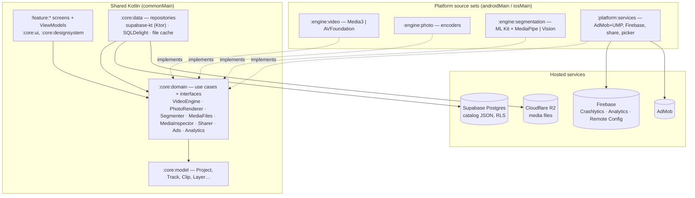

# Technical design

This file is the source of truth (owner, 8 Oct 2026). The "Memix — Product Requirements" Claude Doc (https://claude.ai/code/artifact/c81028c0-e543-4488-ace3-100bdcbb9e10) is the original plan, kept for reference only; changes aren't synced back to it.

## Architecture at a glance

Shared Kotlin code holds the UI, the domain and the data layer; only the video engine, background removal and platform services are written per platform.



Features and data never talk to each other directly: both go through domain interfaces, which also lets iOS swap in its own engines without touching shared code.

## Modules and layers

The code is one Gradle multi-module Kotlin Multiplatform project using clean architecture: presentation and data both depend on domain, and platform engines sit behind interfaces defined in domain.

| Module | Layer | Holds | Depends on |
| --- | --- | --- | --- |
| `:androidApp` | App | Android `Application`, `MainActivity`, manifest (AGP 9 keeps the Android app out of KMP modules) | `:composeApp` |
| `:composeApp` | App | Shared root: `App()`, navigation host, Koin graph, iOS entry point (`MainViewController`); builds the `ComposeApp` framework that `iosApp/` (Xcode) embeds | All feature modules |
| `:core:model` | Domain | Project, Track, Clip, Layer, Effect, Sound and Template entities; serialization | Nothing |
| `:core:domain` | Domain | Use cases; repository interfaces; engine interfaces (`VideoEngine`, `PhotoRenderer`, `Segmenter`, `MediaFiles`, `MediaInspector`, `LocalCalendar`, `Sharer`, `Ads`, `Analytics`) | `:core:model` |
| `:core:data` | Data | Repositories; remote source (supabase-kt on Ktor); local source (SQLDelight); file cache; settings | `:core:domain` |
| `:core:designsystem` | Presentation | Memix tokens, theme, base components | Nothing |
| `:core:ui` | Presentation | Shared composables and the strings both editors use: time formatting; layer gestures, selection frame, handle, guides and bubble (`layers/`); the Position and Canvas panel rows and the stepping logic (`panels/`); the save banner, unsaved sheet, frame edge and canvas frame (`editor/`); the one photo-scene drawing function and the picture-decoder interface (`scene/`); `Res` is public here so features reach the shared strings (the video timeline lives in `:feature:video-editor`, its only user) | `:core:designsystem`, `:core:model` |
| `:engine:video` | Platform | `VideoEngine`: Media3 in `androidMain`, AVFoundation in `iosMain`; the preview surface composable (`VideoPreviewSurface`) the composition root hands to the editor | `:core:domain` |
| `:engine:photo` | Platform | The scene's picture decoder (`SceneImageSource`: `ImageDecoder` on Android, a stub on iOS until P7-09); P2-08 adds the platform encoders (PNG, JPG, GIF, WebP) and draws the scene offscreen | `:core:domain`, `:core:ui` |
| `:engine:segmentation` | Platform | `Segmenter`: ML Kit and MediaPipe on Android, Vision on iOS | `:core:domain` |
| `:platform:services` | Platform | AdMob and UMP, Firebase, share intents; the gallery picker, storage-screen launcher and editor portrait lock (Compose hooks for the composition root) media copies and checks (`MediaFiles`, `MediaInspector`) and the phone's calendar and date format (`LocalCalendar`, P1-14) | `:core:domain` |
| `:feature:onboarding`, `:feature:home`, `:feature:templates`, `:feature:sounds`, `:feature:drafts`, `:feature:video-editor`, `:feature:photo-editor`, `:feature:export` | Presentation | Screens and ViewModels | `:core:domain`, `:core:ui` |
| `:feature:media-import` (P2-12) | Presentation | The import flow every pick goes through: `MediaImportFlow`, the sheet and its state, `ProjectPickImport` (a pick for an open project, by destination), the import strings | `:core:domain`, `:core:ui` |

- **Domain stays pure:** `:core:model` and `:core:domain` live in `commonMain` with no Android or iOS imports.
- **Features call use cases only:** never repositories or engines directly.
- **Platform code** lives only in the `androidMain` and `iosMain` source sets of engine and platform modules, plus the composition root (`:androidApp`, `:composeApp`) for app entry and wiring, such as the SQLDelight driver and debug hand-check hooks (owner, 8 Oct 2026).
- **iOS compiles from day one:** CI builds the iOS framework on every push to a phase branch and every pull request, even before iOS work starts, so Android-only APIs never leak into shared code.
- **State:** each ViewModel exposes one `StateFlow<UiState>` and takes `Intent` events (MVVM with one-way data flow). Editors keep an undo stack of immutable project snapshots in a `ProjectEditSession` (see Project data model → Editing, undo and auto-save).

## Project data model

One serializable `Project` describes both editors, so drafts, templates, undo and export all work from the same data. The code lives in `:core:model` (`app.memix.core.model.project`); this is its shape as built in P1-01. Fields for later features (speed, keyframes, filters, masks, transitions, audio effects, layer lock/opacity, meme formats) are added by the ticket that needs them, with a schema bump.

```kotlin
@Serializable
data class Project(
    val id: String,
    val type: ProjectType,                 // VIDEO or PHOTO
    val name: String,
    val canvas: Canvas,                    // ratio chip, widthPx, heightPx, background (Solid color or Blur)
    val video: VideoTimeline? = null,      // set when type == VIDEO
    val photo: PhotoScene? = null,         // set when type == PHOTO
    val createdAtEpochUs: Long,            // wall clock, µs since 1970 UTC
    val updatedAtEpochUs: Long,            // set on every save; the drafts list sorts by it
    val schemaVersion: Int = CURRENT_SCHEMA_VERSION,
)

data class VideoTimeline(val tracks: List<Track>)   // always exactly one MAIN_VIDEO track

data class Track(
    val id: String,
    val kind: TrackKind,              // MAIN_VIDEO, OVERLAY, TEXT, STICKER, MEME_SOUND, AUDIO, EFFECT
    val items: List<TimelineItem>,    // placed by startUs, never by list index
    val muted: Boolean = false,
    val locked: Boolean = false,
)

sealed interface TimelineItem { val id: String; val startUs: Long; val durationUs: Long }
// MediaClip(source: MediaRef, trimInUs, trimOutUs, volume, audioDetached, fit: FIT|FILL)   MAIN_VIDEO, OVERLAY
// AudioClip(source: MediaRef, trimInUs, trimOutUs, volume)                                  MEME_SOUND, AUDIO
// TextItem(durationUs, text, style: CaptionStyle(fontId, color, outlineColor?), transform)  TEXT
// StickerItem(durationUs, source: MediaRef, transform)                                      STICKER
// EffectItem(durationUs, effect: EffectSpec(id, params: Map<String, Float>))                EFFECT
// MediaClip and AudioClip derive durationUs from trimOutUs - trimInUs; it isn't saved.

data class MediaRef(
    val origin: MediaOrigin, val kind: MediaKind, val cachedCopyPath: String? = null,
    // Measured at import (P1-02, schema 2); null for media added before schema 2:
    val durationUs: Long? = null,      // the whole source file; null for photos
    val pixelSize: PixelSize? = null,  // as shown, rotation and EXIF orientation applied
    val hasAudio: Boolean? = null,     // a sound track this phone can decode; false for photos
)
// MediaOrigin: GalleryUri(uri) on Android, PhotoAsset(localIdentifier) on iOS, CatalogItem(itemId) for meme sounds and stickers

data class PhotoScene(val layers: List<Layer>)   // bottom to top
// Layer(id, transform): ImageLayer(source), TextLayer(text, style), StickerLayer(source)
// Transform: centerX/centerY as fractions of the canvas, scale, rotationDegrees (clockwise)
```

- **Time** is in microseconds (`Long`), matching Media3 and AVFoundation. Wall-clock timestamps are microseconds too, with an `EpochUs` suffix.
- **Media references** hold where the file came from (gallery URI, PHAsset id or catalog id) plus the app's own copy, so a draft survives the original file moving. `cachedCopyPath` and the thumbnail path are relative to the app's files directory, because iOS moves the app container on every update. The source's duration, shown size and whether it has sound are measured once at import (see Media import), so the editor never probes files to open a draft; a draft from before schema 2 has them null, and the editor reads them from the copy when it opens it.
- **Effects, filters and transitions** are declarative specs (an id plus parameters). Each engine renders the same spec, which keeps Android and iOS output alike.
- **JSON:** kotlinx.serialization with a stable `@SerialName` on every polymorphic subtype and enum entry (never rename one). Every field is written (`encodeDefaults`), and unknown keys fail the load instead of being dropped.
- **Storage:** `:core:data` keeps one row per project in the SQLDelight `project` table (`Project.sq`): `project_json` is the whole project and the source of truth; `name`, `type`, `schema_version`, `created_at_epoch_us` and `updated_at_epoch_us` are copied out of it on every save so the drafts list can sort and show rows without decoding projects (`updated_at_epoch_us` descending, then `created_at_epoch_us` descending for ties, P1-14); `thumbnail_path` is nullable and written only by `updateThumbnailPath` (P1-14). A save is one `INSERT OR REPLACE` that keeps the thumbnail, so a killed process leaves either the old row or the new one. The repository never changes a project's times: only `SaveProjectUseCase` (the editors' saves, the first import) stamps `updatedAtEpochUs`; rename, duplicate and an undone delete write through the repository with the times they want (P1-14).
- **Project JSON migrations:** each load parses the JSON, runs it through `ProjectJsonMigrator` (one `ProjectMigration` step per version, listed in `ProjectMigrations.kt`), then decodes it. A shape change bumps `Project.CURRENT_SCHEMA_VERSION` and adds the step that turns version N into N + 1; then open a draft saved before the change. JSON saved by a newer app, or damaged, loads as `AppError.ProjectUnreadable` and stays untouched in the database.
- **Database migrations:** the table itself evolves through SQLDelight: edit `Project.sq` and add `migrations/<version>.sqm` (the first is `1.sqm`). `databases/1.db` is the version-1 schema; `./gradlew :core:data:verifySqlDelightMigration` (run in CI) fails if `1.db` plus the `.sqm` files doesn't equal the `.sq` files. Regenerate a schema file with `./gradlew :core:data:generateCommonMainMemixDatabaseSchema`, in its own Gradle run.
- **Drivers:** the composition root opens the database (`:composeApp` `databaseDriverModule`: `AndroidSqliteDriver` in androidMain, `NativeSqliteDriver` in iosMain, file `memix.db`); `:core:data` stays commonMain only. The iOS framework is static, so `iosApp` links `-lsqlite3`.
- **Editing, undo and auto-save (P1-07):** both editors edit through a `ProjectEditSession` (`:core:domain`, started with `StartEditSessionUseCase`). The ViewModel copies `session.state` (`project`, `canUndo`, `canRedo`, `undoTool`, `redoTool`, `saveFailure`) into its own UiState, sends `commit(tool) { edit }` (returns whether a step was recorded), `undo()`, `redo()` from the main thread, calls `saveNow()` on ON_STOP and registers the session with `addCloseable`, so closing the editor saves too.
  - **Undo:** `ProjectHistory` keeps the current project plus up to 100 earlier and later versions (`MAX_UNDO_STEPS`), in memory only, each with the `EditorTool` whose edit made it. One `commit` is one step; a drag, trim or pinch keeps its in-between positions in UI state and commits once on release. An edit equal to the current project adds no step; a new edit clears redo. The editor turns the tool into words for its "Undo: Split" toast. A recorded `commit` logs `tool_use {editor, tool}` once, and `undo()` and `redo()` log `undo` and `redo`, each only when it changes the project (P1-06).
  - **Leaving a draft with no clips:** `close()` deletes a video draft whose main video track has no clip left (`Project.hasNoClips()`) instead of saving it (owner, 8 Oct 2026). The delete runs under the same write lock as saves, after any write in progress, and nothing is written after close, so a waiting save can't bring the draft back (P1-07 review R4). `DeleteProjectUseCase` deletes its media folder right after the row (P1-14); if that fails, the next start's `LeftoverMediaCleaner` does.
  - **Auto-save:** the newest version is written 500 ms after the last change (`AUTOSAVE_DELAY`; each change restarts the wait), at once on `saveNow()` and `close()`, and not at all if it is already the last version written. Writes run one at a time in the app-owned `appScope` (Koin, `Dispatchers.Default`; the repository encodes and writes on IO), so the newest version always lands last and a closing editor's save still finishes. A failed save keeps the version pending and shows as `saveFailure` (`StorageFull` or `Unexpected`); the next change, `saveNow()` or `close()` tries again.
  - **Process death:** only changes from the last 500 ms, plus the write in progress, are lost; SQLite rolls a half-done write back on the next open, so the previous save reopens intact.
- **Debug hand checks** (debug builds only, logcat tag `MemixProjectCheck`, started from `androidApp/.../ProjectChecks.kt`; the drafts list's `--ez memix.draftsCheck true` is under Drafts list):
  - Round trip (`ProjectRoundTripCheck`): `adb shell am start -S -n app.memix/.android.MainActivity --es memix.projectCheck save`, then `adb shell am force-stop app.memix`, then the same start command with `verify`, logs `identical` or the first difference.
  - Auto-save (`AutosaveCheck`): `--es memix.projectCheck autosave` drives a real `ProjectEditSession` through 110 edits, undo to the limit, 3 redos and one drag, logging every save. Add `--ei memix.killAfterMs <ms>` to end the process with SIGKILL that long after the last change, or `--ez memix.background true` to move the app to the background and end it right after the save that ON_STOP starts. A new start with `autosave-verify` logs which version reopened and whether it is identical.
  - Editor (P1-04, debug **and benchmark** builds: the `memix_hand_checks` resource is true in `src/debug` and `src/benchmark`): `--es memix.openEditor <name>` saves one of `EditorCheckProjects` as a draft and opens it in the video editor (logcat tag `MemixEditorCheck`): `export-check` (P1-03's project), `preview-check` (30 s of 1080 × 1920 at 30 fps on six tracks, the frame-rate check), `preview-error` (overlapping main clips: "The preview stopped"), `missing-media` (a clip whose file is gone), `empty` (no clips; leaving deletes it), and for P1-05 `timeline-check` (20 main clips, 80 s, plus caption, meme-sound and detached "Original audio" lanes; one sound runs 2 s past the end), `timeline-tracks` (the preview check's six tracks plus an overlay and a second meme-sound lane past the end) and `hour-long` (the 1080p clip's first 30 s, 120 times), and for P1-11 `canvas-check` (a 16:9 video, a 9:16 video and a 4:3 photo, Fit on black, four captions: large at the top, turned near the right edge, half off the left edge, in the middle). In the editor, a long-press on the timecode runs `DebugEdits.shortenLastClip` (1 s off the last clip, or removes a clip of 1 s or less), a real undo step named `trim`, for the undo, redo, toast and save-banner checks until P1-06. `--ez memix.failImportSave true` makes the next import's first save fail once with `StorageFull` (`ImportSaveFailure`, wrapped around the import's `SaveGalleryProjectUseCase` only), for the P1-02 N2 check. Every editor save logs the values that changed since the stored draft under `MemixEditorCheck` (`EditorSaveDiffLog`, wrapped around the edit session's save; items named by id, `updatedAtEpochUs` left out), for P1-16's "only the clip's source and trim changed" check. Media and commands: `docs/qa/phase-1/engineer-hand-checks.md` → P1-04.

## Media import

How picked videos and photos get into a project (P1-02; the editor's Add media and Replace reuse it, P1-16). Screens and copy: `docs/ux/specs/P1-02-gallery-picker.md`, `P1-06-clip-edits-and-audio.md` → Add media, Replace.

- **Picker (Android):** androidx.activity's `PickMultipleVisualMedia` (images and videos, ordered selection, at most `MAX_ITEMS_PER_PICK` = 35 or `MediaStore.getPickImagesMaxLimit()` if lower); Replace's one item uses `PickVisualMedia`, because `PickMultipleVisualMedia` requires a maximum above 1 (androidx.activity 1.13). androidx.activity picks the system photo picker, else the Play services backport (installed through the `ModuleDependencies` entry in `androidApp`'s manifest; Android 10 and phones without Google system updates), else `ACTION_OPEN_DOCUMENT`, which ignores the limit, so the import keeps the first 35. No accent color, no default tab, no HDR transcoding (the engine tone-maps), and no persistable URI permission: the project uses Memix's copy, never the original.
- **No permissions:** the merged manifest declares no media or storage permission; `androidApp`'s manifest removes `READ_EXTERNAL_STORAGE`, `WRITE_EXTERNAL_STORAGE`, `READ_MEDIA_IMAGES`, `READ_MEDIA_VIDEO`, `READ_MEDIA_AUDIO` and `READ_MEDIA_VISUAL_USER_SELECTED` with `tools:node="remove"` in case a library adds one.
- **Where the code lives:** the picker and the storage screen are Compose hooks (`rememberMediaPickerLauncher`, `rememberFreeUpSpaceLauncher`, expect/actual in `:platform:services`), registered once at the app root (`:composeApp` `MemeImport`, one instance for Video meme and one for Photo meme), so a result that arrives after Android restarted the app still reaches them. The root hands the result to `MediaImportViewModel` (`:feature:video-editor`) as an intent. The copying, the sheet's timing, the space wait and the results are `MediaImportFlow` (`:feature:media-import`; it lived in `:feature:video-editor` `importmedia/` until P2-12 moved it, because the photo editor needs it too), shared with the editors' imports: it calls `ImportMediaUseCase` (prepare → space check → copy and check), then hands the copies to an `ImportLanding`, which says `Landed`, `Declined` (the copies are deleted) or `Failed`. For Create → Video meme, landing is `SaveGalleryProjectUseCase`, which places the media and makes the first save; `ImportUiState.Done` then opens the editor. Disk and checks sit behind `MediaFiles` and `MediaInspector` (`:core:domain`, Android implementations in `:platform:services`).
- **Copies:** `files/media/<project id>/<random id>.<extension>` (`MediaPaths`); one folder per project. The extension comes from the MIME type, else the file name, else the kind's default (`mp4`, `jpg`), and must be 1–8 letters or digits, because Media3 recognizes photos by it. Bytes go to `<name>.part`, are synced to disk and renamed when complete, so a file under its real name is always whole. Copying runs on IO in 256 KB reads and checks for cancel between reads.
- **Cleanup:** Cancel, Close or a failed check deletes that pick's copies at once (including a copy that finished just as Cancel landed). At every app start, `LeftoverMediaCleaner` (a Koin single created at start, running in `appScope`) deletes every `.part` file and the folder of every project that isn't a saved draft (Android stopped the app mid-import, or a draft was deleted); imports, duplicates, deletes from the drafts list and thumbnail writes wait for it. If the drafts can't be read, it deletes nothing. It logs how long it took (`Cleanup checked N drafts in M ms`, tag `MediaImport`; P1-14 bar: under 300 ms with 25 drafts).
- **When copies are deleted (P1-16):** a replaced or deleted clip's copy stays while the editor is open, because undo lives in memory and can bring it back. At the next app start, the cleaner also deletes the files in a saved draft's folder that the draft no longer uses (`Project.mediaCopyPaths()`: every clip, sound and sticker; split and duplicated clips share one copy; plus the draft's thumbnail). A draft saved since this start is skipped, since an editor of this run may have it open; a draft that can't be read keeps everything. So the owner's check is: replace, close, `adb shell am force-stop app.memix`, start again, and the old copy is gone.
- **Space:** before copying, `StorageManager.getAllocatableBytes` must cover the known sizes of what's left plus `HEADROOM_BYTES` (100 MB); then `allocateBytes` asks the system to clear other apps' caches for it. Unknown sizes count as zero, so a copy can still run out: a failed write that reports `ENOSPC`, or any failed write with less than 256 KB free, stops the import with what's done kept for the retry. "Free up space" opens `ACTION_MANAGE_STORAGE` with `EXTRA_REQUESTED_BYTES` (else the internal storage settings; else the button goes away); the space is checked again whenever the app returns to the foreground.
- **Checks and facts:** each copy is checked before it counts. A video needs a video track this phone has a decoder for (`MediaExtractor` + `MediaCodecList`; Dolby Vision may fall back to its HEVC or AVC base layer) and a duration over zero; a photo must decode (`ImageDecoder`, at about 512 px). The check records the source's duration (longest track), its shown size (rotation and EXIF orientation applied) and whether it has a sound track this phone can decode. A failed check deletes the copy and the item shows as "won't play"; a source that can't be opened or read to the end shows as "can't be read".
- **Placement:** in pick order on the main video track, back to back from 0 µs: videos at full length with their own sound, photos for `PHOTO_CLIP_DURATION_US` (3.0 s). A new project is created in memory with an empty name and saved once, when at least one item went in, which also logs `project_create` (`editor: video`, `source: gallery`). Nothing is saved for a pick that was backed out of, cancelled or where nothing went in.
- **First save fails for space** (P1-04, owner 8 Oct): when the copies are done but the new project's first save reports `StorageFull`, the import keeps the copies and shows "Not enough space" asking for the headroom (`ImportMediaUseCase.spaceToSaveAgain`). Back in the foreground with room, it saves again without copying (no Copying state), then opens the editor or "Some didn't go in"; Close deletes the copies. Any other save failure still shows "Couldn't add your media" with no rows.
- **Into the editor:** a sheet that was up stays, unchanged, while the editor's 320 ms push covers it (`ImportUiState.Done.sheetShown`; `ImportIntent.Finish` follows the push), and the tabs, bottom nav, scrim and sheets live in one `MainRoute` destination under the editor, so the push slides over them.
- **Progress:** by bytes when every size is known, else an equal share per item; at most 10 sheet updates a second (`CopyProgressTracker`); time left from the average speed over the last 2 s, shown after 2 s and only above 10 s. The import sheet appears only when copying takes longer than 300 ms and then stays at least 500 ms.
- **Backups:** `files/media` is excluded from the cloud backup (`data_extraction_rules.xml` on Android 12+, `backup_rules.xml` on 10 and 11), because one video exceeds Android's 25 MB backup quota, and over the quota Android backs up nothing at all. Drafts (the database) are still backed up; a draft restored on a new phone has no media copies and opens as the editor's "missing media" case (P1-04, P1-14). Device-to-device transfers on Android 12+ carry everything.
- **Process death:** copying carries on while the app is in the background. If Android stops the app mid-import, the picker's access ends with it; the next start deletes the unfinished files, and a first import leaves no project.
- **iOS (P7-08):** `PHPickerViewController` and copies into the same folder layout; until then iOS shows "Can't open your gallery", and its `MediaFiles` and `MediaInspector` are stand-ins.
- **Media copies are never changed in place (P1-14).** A duplicated draft may share its files with the original through hard links (iOS, P7-08), so writing into an existing copy would change both drafts. Every later feature that produces media (P2's masks, P4's crop and rotate, anything else) writes a new file under a new name and points the project at it; the cleaner deletes the old one when nothing uses it.
- **From the editor (P1-16):** the Add media tool (main tool bar) and the Add media tile (after the end of the video) pick up to 35 items; Replace (main clips) picks one. The editor asks for a picker through `VideoEditorUiState.mediaPicker` (`MediaPickRequest.Add(MediaPlace)` or `Replace(itemId)`); the root's `EditorMediaPickers` opens it and keeps the request in `rememberSaveable` while it's open, so a result after Android restarted the app comes back with what it was for (`MediaPicked(request, items)`), and the landing waits until the draft has opened. `EditorMediaImport` (`:feature:video-editor`) runs a `MediaImportFlow` into the draft's own folder and lands through the edit session: `insertMedia(media, clipIds, place)` (`project/MediaEdits.kt`: the tool lands after the main clip under the playhead, exactly on a boundary at that boundary, at or past the end appended, never splitting; the tile always appends; an empty project from 0:00; later main clips move right by the added length and other lanes keep their times) as one "Add media" step, or `replaceClipMedia(itemId, media)` as one "Replace" step when `replaceFit` says it fits (a photo, or a video at least as long as the clip, used from 0; the clip keeps its id, start, length, place and volume; a clip whose sound was detached gets its new sound attached at 0%, and its detached audio clip stays). A shorter video is `Declined`: its copy is deleted and "That video is shorter than this clip" names the clip's length. The import sheet draws over the editor with its own scrim and reads the import's state itself (`EditorMediaImportUi`), so only it redraws while copying. After the sheet has gone, the playhead moves to the first new clip and the new clips bonk together (`LandedItems`), or the replaced clip bonks; focus returns to the opener. `tool_use` `add_media` (once per pick) and `replace_clip`; no `project_create`.

## Drafts list (P1-14)

The Drafts tab: every saved draft, last edited first, with open, rename, duplicate and delete with undo. Screen and copy: `docs/ux/specs/P1-14-drafts.md`.

- **Where the code lives:** `:feature:drafts` (`DraftsViewModel`, `DraftsScreen`, `DraftRow`, `DraftsSheets`, `DraftsToastHost`, `DraftThumbnailImages`); use cases in `:core:domain` `drafts/`. The ViewModel is created by the app's main destination (`MainShell`, scoped to `MainRoute`), so the rename and copy sheets and the toast sit over the bottom navigation and the list is still there when an editor closes; the list is read from the first time the tab shows. The tab reports `Shown`/`Hidden` with its lifecycle.
- **Order:** `ObserveProjectSummariesUseCase` (`updated_at_epoch_us` descending, `created_at_epoch_us` descending for ties; the list never decodes a project). Opening a draft writes nothing (P1-07 saves only changes); `RenameDraftUseCase` writes the cleaned name (line breaks to spaces, trimmed, 60 user-perceived characters by `Graphemes.kt`; empty = unnamed, shown as "Untitled video meme" in the user's language) with `ProjectRepository.save`, keeping the edit time. `ProjectSummary` carries `createdAtEpochUs` and `schemaVersion`; a draft above `Project.CURRENT_SCHEMA_VERSION` shows "Needs a newer version of Memix" and only Delete works (by id, no decode).
- **Back from the editor:** the ViewModel remembers the opened draft's edit time; if the row's time changed (within 2 s of coming back, since the editor's last save lands after its screen has gone) the list scrolls to the top and focuses it, otherwise focus returns to its row. An editor that can't open a draft (damaged, from a newer app, or deleted meanwhile, such as P1-12's "Open draft" toast after a delete) closes with `couldntOpen`, and the app shows "This draft can't be opened" through the drafts toast, on whichever tab is showing.
- **Duplicate** (`DuplicateDraftUseCase`): a new id, `createdAtEpochUs` now, `updatedAtEpochUs` the original's + 1 µs (so it sits directly above its original until edited; a second copy ties and goes first by its newer creation time), "{name} (copy)" then "(copy 2)" and on, the original's part shortened to keep 60 characters, a copy of an unnamed draft unnamed; no `project_create`. Every file in the original's own folder (`Project.mediaCopyPaths()` plus the thumbnail) goes to `media/<copy id>/` under the same name, and every path in the copy is rewritten into that folder (`withMediaCopyPaths`); shared files outside it (bundled sounds, `debug-media/`) stay shared. Each file is first offered to `MediaFiles.link` (a hard link), else copied with `copyFile` (`.part` + rename, progress); only copied files need space (their sizes plus the 100 MB headroom, `reserveBytes`). A missing source file is skipped and its clip keeps its path in the new folder, so the copy opens in the same missing-media state. The row is saved (`saveWithThumbnail`) only after every file is in place; cancel, a full disk or a failed save deletes the new folder, and a kill leaves it to the next start's cleaner. The copying sheet shows only after 300 ms; "Not enough space" retries when the app comes back to the foreground. Each file's route is logged (`Duplicate: <file> linked | needs a copy | copied`, tag `Drafts`).
- **Hard links on Android:** AOSP's SELinux policy forbids them to apps (`neverallow all_untrusted_apps file_type:file link`, in `app_neverallows.te` since 2015), so `Os.link` fails with `EACCES` on every phone and duplicates copy; `AndroidMediaFiles` stops trying after the first refusal in a run. iOS's `FileManager.linkItem(at:to:)` does make hard links inside the app's container (P7-08). See "Media copies are never changed in place" under Media import.
- **Delete with undo** (`DeleteDraftUseCase`, a Koin single in `appScope`): `ProjectRepository.remove` deletes the row and returns it whole (`RemovedDraft`: the summary and the stored JSON, no decode), held in memory with the media folder on disk for the undo window: 8 s, or the user's "Time to take action" setting (`calculateRecommendedTimeoutMillis` with controls), passed in by the screen. Undo `putBack`s the row byte for byte (same id, times, name, thumbnail), so it returns to its place. When the window ends the folder is deleted; a second delete ends the first one's window at once. The window runs in the app's scope, so leaving the tab or rotating can't strand a folder; if the app dies first, the next start's cleaner deletes the folder of a draft that's no longer saved. The toast follows `undoable`; the ViewModel keeps the latest one, so when another toast (Duplicated, CantOpen, a failure) times out while the delete can still be undone, the Deleted toast with Undo comes back. A failed rename, duplicate or delete shows its own 4 s toast (`RenameFailed`, `DuplicateFailed`, `DeleteFailed`); only `ProjectUnreadable` shows "This draft can't be opened".
- **Thumbnails** (`UpdateDraftThumbnailUseCase`, a Koin single in `appScope`, one draft at a time): the cover is a video's first main clip at its trim-in, or a photo's lowest image layer (`Project.cover()`); a 192 px square JPEG from the engine's `ThumbnailReader` is written to `media/<id>/thumb-<cover file name>-<trim-in µs>.jpg` and `thumbnail_path` updated with `setThumbnailPath` (the edit time is untouched), then the old file is deleted. Because the name encodes the cover, a draft whose saved path already matches is skipped after one indexed query: nothing is decoded unless the first clip or its trim-in changed. It runs after the first save (`SaveGalleryProjectUseCase`), when the editor goes to the background and when it closes; a draft saved before P1-14 gets its thumbnail the first time an editor leaves it. The list reads the file through `ReadDraftThumbnailUseCase` and decodes it once off the main thread (`DraftThumbnailImages`, an in-memory cache of up to 60 by path); the image fades in over 120 ms.
- **Edit times** (`DescribeEditTimeUseCase` over `LocalCalendar`, `:platform:services`): under a minute "just now", minutes, hours under 24 h, the previous calendar day "yesterday", 2 to 6 calendar days, then a short date in the user's language (`DateFormat.getBestDateTimePattern` "dMMM", with the year when it isn't this year). One tick for every row: on `Shown` and once a minute while shown. iOS has a UTC stand-in until P7-08.
- **Opening time:** the app logs `Draft opened from the drafts list` under `MemixPreview` at the tap; the engine's `Preview opened in N ms` follows under the same tag, so logcat's timestamps give tap → first frame (PRD: under 1 s).
- **No analytics events** (spec → Analytics): rename, duplicate and delete log nothing, and a duplicate never reaches `project_create`.
- **No schema or table change:** the list query and `ProjectSummary` changed and four queries were added (`selectRowById`, `selectThumbnailPathById`, `updateThumbnailPath`, `insertWithThumbnail`); the table and the project JSON are as before, so no `.sqm` and no `schemaVersion` bump.
- **Debug hand check** (debug and benchmark builds): `adb shell am start -n app.memix/.android.MainActivity --ez memix.draftsCheck true` saves 25 drafts (`DraftsCheck`, logcat tag `MemixDraftsCheck`) with spread-out edit times covering every wording, one unnamed, one with a 60-character name, one with a schema version above this app's and one whose media folder is missing; the others each get their own copy of the pushed `debug-media/clip-a.mp4` and a thumbnail. Steps: `docs/qa/phase-1/engineer-hand-checks.md` → P1-14.

## Meme sounds (P1-08)

The starter pack and the editor's sound tools. Screens and copy: `docs/ux/specs/P1-06-clip-edits-and-audio.md` → Meme sounds sheet, Meme sounds, Move, Volume panel; `P1-05-timeline.md` → "Add a meme sound" row.

- **Starter pack:** the 10 CC0 sounds and `manifest.json` from `content/starter-sounds/` are copied into `:platform:services` Compose resources (`composeResources/files/starter-sounds/`), so Android and iOS read them the same way (`Res.readBytes`). `content/starter-sounds/` stays the source: a re-encoded sound is copied there and here together, and the manifest's `sha256Output` tells if they differ. The license proofs (`licenses/`) and the README are not bundled. About 443 KB of the APK (453,633 bytes stored; the m4a files aren't compressed again).
- **`SoundLibrary`** (`:core:domain`, `BundledSoundLibrary` in `:platform:services`): `starterSounds()` reads the manifest once per run into `CatalogSound`s (permanent catalog id, title in every app language as `LocalizedText`, length, credit = the license's attribution or else its type, "CC0"); `fileOf(sound)` writes the sound to `files/sounds/<catalog id>.m4a` the first time it's needed in a run (`MediaFiles.write`: temporary name, synced, renamed) and returns a `MediaRef` with `CatalogItem(id)` as its origin. That file is shared by every project, sits outside `media/` so the leftover cleanup never touches it, and is left out of backups (`sounds` in both backup rule files): the app writes it again from itself. `PrepareSoundUseCase` checks it with `MediaInspector` and uses the measured length, so trims and the end rule match the file that plays; a sound that doesn't decode is "That sound won't play".
- **Titles on the timeline:** a project keeps only the catalog id; the editor labels each sound with the pack's title by id, in the app's language (`ItemLabel.SoundTitle`, resolved with `LocalLocale` where it's drawn and spoken). No schema change, and a later catalog fix reaches old drafts.
- **Sheet previews:** `VideoEngine.openSoundPlayer()` → `SoundPlayer` (Android: one ExoPlayer, media audio focus, stops on noisy and on focus loss instead of resuming), opened on the first play and closed with the editor. One sound at a time; the editor stays paused.
- **Edits** (`:core:domain` → `project/SoundEdits.kt`, `MoveEdits.kt`): `addSound` lands the whole file at 100% at the playhead, or, with the playhead within one frame of the end, so it ends at the end (`startAtPlayhead`); on the first meme-sound lane free for its whole length, else a new lane right after the last one. `moveItem(itemId, startUs, LaneTarget, newTrackId)` moves any item but a main clip: never before 0:00, on the lane it's dropped on (`LaneTarget.Lane`; a lane of another kind counts as its own) or a new one (`NewLane`, the add row); if it would overlap there it goes to the next free lane of its kind, else a new one; a lane it empties goes in the same step; a drop where it was changes nothing. `moveItemToPlayhead` is Move here (same end rule). `setVolume` holds 0–200% (`MAX_VOLUME`).
- **Analytics:** `sound_add {sound_id, tab: "starter", editor: "video"}` once per landing and `sound_preview {sound_id, tab: "starter"}` per play (`LogSoundEventsUseCase`). The landing is an undo step ("Add sound", `EditorTool.ADD_SOUND`) with no `tool_use`, because `sound_add` counts it (the PM's `tool_use` ids have no add-sound value); Move and Volume log `tool_use` `move` and `volume`.
- **Volume heard live:** while the Volume slider moves, `PreviewSession.previewVolume(itemId, volume)` changes a `LiveGainProcessor` that every preview composition puts on each sound (a volatile gain the audio thread reads; clamps at full scale like Media3's `ChannelMixingAudioProcessor`), so the change is heard at once without a rebuild. The release commits one Volume step, which rebuilds as any edit does; export never has the live gain. Since P1-09 main clips playing their own sound get one too, and preview compositions keep items at 0% (`CompositionPlanner.plan(keepSilentItems = true)`) with no fixed volume step and the live gain at 0, so raising one from 0% is heard while the slider moves; export plans still leave them out.
- **Sync measure (P1-08 Done when):** in builds with hand checks (Koin property `memix.handChecks`), every preview composition carries `SoundOnsetLog`, a pass-through audio processor on the whole mix. Media3 1.11.1 flushes composition audio processors with the seek position (`AudioGraph.flush` → `StreamMetadata.positionOffsetUs`, read in the tagged source), so each sample's timeline time is that position plus the samples since; after at least 50 ms of silence, the first sample over −40 dBFS logs `Sound onset: heard at T, placed at S, off by D` under `MemixPreview`, against the nearest sound start in the plan. It measures where the sound sits in the mixed audio, which Media3 then shows video frames against; the phone's own output delay is the owner's ear check. The export is measured from the file (`--ez memix.exportLatestDraft true` exports the draft edited last and logs where each sound starts; then `ffmpeg`/`ffprobe` on a computer). Steps: `docs/qa/phase-1/engineer-hand-checks.md` → P1-08.
- **iOS (P7):** `SoundPlayer` plays nothing and `MediaFiles.write` fails, so a sound "won't play"; the bundled files already reach the iOS framework through Compose resources.

## Original audio (P1-09)

The sound recorded in the user's own videos. Screens and copy: `docs/ux/specs/P1-06-clip-edits-and-audio.md` → Original audio, Clip tool bar, Volume panel; `P1-05-timeline.md` → Leading area.

- **Model:** no new fields and no schema change. "Mute every clip" is `Track.muted` on the main track; a clip's level is `MediaClip.volume`; a detached clip has `audioDetached = true` and its sound is an `AudioClip` on an `AUDIO` lane pointing at the same file.
- **Edits** (`:core:domain` → `project/OriginalAudioEdits.kt`): `setOriginalMuted(muted)`; `originalSoundOf(itemId)` says whether a main clip's own sound `PLAYS`, is `NONE` (a photo, or a video with `hasAudio == false`) or is `DETACHED`; `hasOriginalAudio()` is true while any main clip's sound plays when unmuted (the toggle shows only then); `detachAudio(itemId, audioClipId, newTrackId)` adds an `AudioClip` with the clip's source, trims and volume at the clip's start (0% while every clip is muted, so nothing gets louder) on the first Audio lane free for that span, else a new lane, and sets `audioDetached`. Each is one undo step ("Mute original audio", "Unmute original audio", "Detach audio"); there's no re-attach but Undo.
- **Editor:** `OriginalAudioControl` (behind `EditorHost`) flips the mute without pausing playback and runs Detach audio: the new clip is selected and bonks (no haptic: that's for meme sounds) and is announced, or, detached while muted, the stage explains it starts at 0%. Volume and Detach audio on a video with no sound or an already detached clip explain instead; photos have neither tool. Detach audio on a clip whose file is missing shows the missing-file toast and changes nothing (the screen passes `fileMissing` from the thumbnails' missing sources; a detached clip of a missing file would play nothing and outlive the Replace that fixes it, P1-09 review M2). Duplicating a detached clip gives the copy its own sound back at 0% (`audioDetached` false, volume 0, the Replace rule; Split keeps both pieces detached, P1-09 review P1). `VolumePanelControl` opens "This clip" for a video clip with the "Mute original audio of every clip" toggle row under the slider.
- **Toggle:** `OriginalAudioToggle`, a real composable in the timeline's leading area: a `track-height-video` square, its right edge `space-2` before 0:00 in the main row, inside a 48 dp target, placed from the playhead time and zoom at placement (moves without recomposing) and clipped below the ruler. A screen-reader switch "Original audio", read right after the playhead (`traversalIndex`). Hidden in reorder mode, while a trim or move is held, when `hasOriginalAudio()` is false, and while the selected main clip starts less than `touch-target` after 0:00, because that clip's start handle target reaches over it (P1-09 review, M1; zoom read in `derivedStateOf`, as for the Add media tile).
- **Engine:** unchanged mapping (a muted track or a detached clip plays no clip sound; the detached `AudioClip` plays the same file span once), so detaching never doubles or shifts the sound. Clip volume is heard live through the clip's `LiveGainProcessor` (Meme sounds → Volume heard live).
- **Analytics:** `tool_use` `mute_original` and `unmute_original` per flip (toggle or panel row), `detach_audio` per detach, `volume` per release; nothing for an explanation.

## Captions (P1-10)

Text over the video. Screens and copy: `docs/ux/specs/P1-10-text.md`; the fixed caption look: its Caption rendering section and `design/tokens.json` → `caption`.

- **Content in one place:** `CaptionCatalog` (`:core:model`): the five fonts (ids `anton`, `poppins`, `baloo2`, `kalam`, `rozha`, saved in drafts and never renamed; Classic draws Devanagari in Teko Bold), the ten-color palette, the default style (Classic, white, black outline) and the geometry (font size 8% of the canvas's shorter side, wrap at 90%, outline = size ÷ 12 with round joins under the fill, scale 25–500%, 250 characters). Changing any of it changes old drafts: a schema bump and a compensating migration. No new model fields: `TextItem.text`, `CaptionStyle`, `Transform`.
- **One renderer** (Decision row): `AndroidCaptionRenderer` (`:engine:video` androidMain) lays each caption out once in canvas pixels with `StaticLayout` (lines centered, letter spacing 0, line heights from the fallback fonts too) and draws it scaled to whatever shows it. The typefaces come from the bundled TTFs (`:core:designsystem` font resources, read through `CaptionFontSource`, which the composition root binds to `readCaptionFontFile`) with `Typeface.CustomFallbackBuilder`: each font, then Teko for Classic, then the system font (emoji, other scripts); the fallback keeps every cluster in one font. Three users: the preview's and the export's `CaptionOverlay`, the editor's stand-in (`CaptionStandIn`, a composable in `:engine:video` the root hands to the editor, like the preview surface), and the editor's measures (`CaptionMeasurer` in `:core:domain`, through `PrepareCaptionsUseCase` and `MeasureCaptionUseCase`) for the selection frame and hit tests. iOS: an estimated measurer and an empty stand-in until P7-04.
- **In the engine:** the planner lists `CaptionClip`s in draw order (text lanes from the first, so a lower lane draws on top), cut at the end of the video, blank ones left out. `CaptionOverlay` is a composition-level `CanvasOverlay` the size of the frame: it sees composition time (Media3 1.11.1, read at the tag: the player adds `inputBufferTimestampAdjustmentUs` before the video graph, Transformer adds each item's `offsetToAddUs` before any effect), so a caption spans clip cuts; it redraws only when the set of captions shown changes. A lower export resolution (`ExportSettings.shortSidePx`, set only by the debug hook until P1-12) draws every clip at that frame size and the overlay scales the canvas-pixel layout to it (P1-11), so captions are never laid out again.
- **Live editing:** typing, gestures and held Position arrows change only the stand-in, never the project; each commit (Done, release, a panel tap) is one undo step and one `PreviewSession.update`. While a caption is edited, `PreviewSession.hideCaption(itemId)` leaves it out of the paused frame without a rebuild (a seek to the same position redraws the frame through the overlay; each composition has its own hide switch, and `update` starts the next one with nothing hidden). After a commit the editor keeps drawing the stand-in until the preview has caught up (`VideoEditorUiState.captionStandIn`, cleared once `isCatchingUp` has come and gone, or after 2 s), so nothing jumps or flashes.
- **Editor:** `CaptionControl` (behind `EditorHost`): the Text tool (main tool bar place 3, Add media place 4) and Edit text open typing; every way out commits (blank new adds nothing, blank edit deletes as one step); landing at the playhead for 3 s (or ending at the end), on the top, bottom or middle slot not taken by a caption shown there, on the first free text lane, in the last style of this visit. Style and Position panels (`captions/TextPanels.kt`, ToolPanels behind `coveredByModal`); text tools Edit text · Style · Position · Delete · Split · Move here · Duplicate. The stage (`captions/CaptionLayer.kt`, `CaptionGestures.kt`) draws the two-tone frame, the handle, snap guides and the value bubble, and handles tap, drag, pinch and the handle inside the stage's own tap (touches off captions still play or pause). One canvas frame rectangle (`CanvasFrameRect`) places the preview and the captions; while typing it never grows or moves. The 250-character limit counts grapheme clusters with a pure commonMain counter (`text/Graphemes.kt`, UAX #29 incl. Indic conjuncts), so Android and iOS agree.
- **Analytics:** `tool_use` `add_text` and `text_font` with `font` (the font id), `edit_text`, `text_color`, `text_outline`, `position_text`, `transform_text`, and P1-06's ids on text; a caption cleared to blank logs `delete`.

## Photo editor (P2-01)

Screens and copy: `docs/ux/specs/P2-01-photo-editor-shell.md`; the fixed rules: `design/tokens.json` → `photo`.

- **Model:** `Layer` (`ImageLayer`, `TextLayer`, `StickerLayer`) gained `locked`, `hidden` and `opacity` (defaults unlocked, shown, 1.0; schema 2 → 3, a version-only `ProjectMigration`, because the codec writes defaults and old JSON decodes as it is). `PhotoCatalog` (`:core:model`) holds the blank canvas (1:1, 1080 × 1080, white), the photo-shape tolerances, the image scale range (10% to 500%), the opacity range (10% to 100%), the duplicate offset (3% of the shorter side), the image ratio-change margin (0), the decode cap (4096 px) and the size ladder (10% and 15% below the text ladder). `PhotoGeometry` has the arithmetic every renderer shares: `fittedImageSize` (an image at scale 1 is the picture fitted inside the canvas, or covering it when its shape is within 1%), `turnedBounds`, `hasSameShape`.
- **Edits** (`:core:domain` → `project/LayerEdits.kt`, `PhotoCanvasEdits.kt`, `LayerFit.kt`): `setLayerTransform`, `setLayerOpacity`, `setLayerLocked`, `setLayerHidden`, `deleteLayer`, `duplicateLayer` (above its original, offset, unlocked, the same media file), `moveLayerUp/Down`, `reorderLayer` (a drop, from the front), each one `Project` change. The locked layer's refusals live there: edits return `LayerEdit.Edited` or `Refused(LOCKED | ONLY_LAYER | ALREADY_FRONT | ALREADY_BACK)`, so gestures, tools and TalkBack actions reach one rule. `photoCanvasFor(photo)` is the canvas from a photo's shape (preset within 1%, else the custom ratio with the fewest terms within 1%, else 31:13 or 13:31); `setPhotoCanvasRatio` changes the canvas and, in the same step, keeps every image that was fully inside the old frame fully inside the new one (`Transform.keptInside`, the one rule that captions on a video use too, with their own margin and scale floor). `photoBackgroundShows()` drives the Canvas panel's hint line.
- **Sessions:** the editor uses `ProjectEditSession` like the video editor. A blank canvas is made in memory (`CreatePhotoProjectUseCase`, `StartEditSessionUseCase(project, newSource = BLANK)`): nothing is written until a committed step leaves a layer, which also logs `project_create` (`photo`, `blank`); `isEmptyDraft()` (a video with no clip, a photo with no layer) makes closing delete the draft. A gallery start saves once the photo lands (`SaveGalleryPhotoProjectUseCase`). The Create sheet's blank row is behind `BLANK_ROW_VISIBLE` (off until P2-03).
- **Media:** `mediaCopyPaths()` is a set, so two layers sharing a file (Duplicate) list it once, and `DuplicateDraftUseCase` copies it once and rewrites both layers' paths. Nothing deletes a media file at edit time: the leftover cleaner runs at start and keeps every file a saved draft uses.
- **One scene-drawing function** (`:core:ui` → `scene/SceneDrawing.kt`, `drawPhotoScene`): a `DrawScope` function that fills any pixel size, bottom to top, hidden skipped, opacity and transform applied, clipped at the canvas edge. The editor draws it at screen size inside the frame; the debug render hook draws it offscreen into an `ImageBitmap`; P2-08 will call it at export size. It lives in `:core:ui`, not `:engine:photo`, because the editor feature must draw it live and a feature may not depend on an engine; `:engine:photo` supplies what needs the platform (`SceneImageSource`, `AndroidSceneImageSource`: `ImageDecoder`, EXIF applied, scaled while decoding, hardware bitmaps for the screen and software ones offscreen).
- **Smoothness:** a gesture moves a layer in the draw phase: `LayerStageState.gesture`, `PhotoLive` (the released place, held arrows, the opacity slider) and the frame are state read inside the draw lambda, so the scene isn't recomposed per frame and the project changes once, on release. `SceneBitmaps` decodes each file once at the size its biggest layer is drawn at on the frame without a panel (never above the source or 4096 px), and again only when a committed change moves that size by 25% or more; a panel opening animates `stage.frame` (200 ms) and the existing bitmaps draw smaller. Bitmaps and row thumbnails (`LayerThumbnails`, 128 px, fitted inside) are dropped when the screen leaves.
- **Lift:** P1-10's caption gestures, frame, handle, guides and bubble, the Position panel, P1-11's ratio, custom-ratio and swatch rows, the stepper rows, the save banner, unsaved sheet and frame edge moved into `:core:ui` with the strings they use (73 keys, five languages); `CaptionUi` implements `GestureTarget`. The video editor uses them with no behavior change (a throwaway JVM harness compared the old and the shared ratio rule on 20,000 random captions: equal, except that the old rule threw an empty-range error in 11 of them, which the shared one avoids by centering).
- **Layers panel:** `ToolPanel` gained `contentMaxHeight` (as tall as the content up to 40% of the window), `headerActions` (the Move buttons, wrapping under the title) and `scrolls = false` (a lazy list scrolls itself); `LayerRow` is a design-system component. Reorder by drag is a long press (LongPress haptic) with the dragged row swapped live past each neighbour, `animateItem` sliding the others, and the list scrolling near its edges; the drop is one `reorder_layer` step. Review fix (28 Oct): when the panel cap is under 300 dp or the font scale is 1.3 or more, the Opacity row is the list's first item (key `"opacity"`, never a drop target; scroll-to-selected adds 1) so the list keeps room for two rows. `ToolBar` takes `scrollResetKey`: the photo editor passes `layer.locked`, so the bar returns to its start when Lock or Unlock reorders it (a locked layer's bar starts with Unlock).
- **Analytics:** `tool_use` `transform_layer`, `position_layer`, `layer_opacity`, `lock_layer`, `unlock_layer`, `hide_layer`, `show_layer`, `reorder_layer`, plus the shared `delete`, `duplicate`, `undo`, `redo`, `canvas_ratio` and `canvas_background`, all with `editor: photo`.
- **Debug hooks** (debug and benchmark builds): `--es memix.openEditor photo-layers-10 | photo-empty | photo-missing-media | photo-background-image | photo-background-missing (P2-12; the video editor's `canvas-image-check` too)` (`PhotoCheckProjects`; the pictures are generated on first use under `files/debug-media/photo-scenes/`, the photo-shape set included), and `--es memix.renderScene <project id> --ei memix.renderWidth 1080` writes the saved scene to `cache/scene-renders/<id>-<width>.png` through the same drawing function (logcat tag `MemixSceneRender`).


## Canvas background picture (P2-12)
- **Model:** `CanvasBackground.Image(source: MediaRef)` (`@SerialName("image")`) beside `color` and `blur`; the model holds one background, so picking a color or Blur drops the picture (Undo brings it back as one step). Defaults after Remove: video black (`CanvasCatalog.VIDEO_BACKGROUND`), photo white (`PhotoCatalog.BACKGROUND`). Domain edits in `CanvasEdits.kt`: `backgroundImage`, `setBackgroundImage`, `removeBackgroundImage`. Analytics: `canvas_background` with `value` `image` (a pick or Replace), `color` (Remove or a color) or `blur`; nothing about the picture.
- **Cover rule:** `coveredImageSize(image, canvas)` in `:core:model` (`PhotoGeometry.kt`): scaled uniformly to cover, centered, the overflow cropped; `MediaRef.pixelSize` is the size as shown. The photo scene (`drawPhotoScene`) and the video engine both use it, so a picture lies the same in the preview and the export.
- **Photo:** `drawPhotoScene` draws black, then the picture (cover), then the layers; the picture isn't ready or its file is missing: black. `SceneBitmaps` decodes it once at the size that covers the canvas (`neededLongSides` counts it like a layer); a decode failure reports the path (`MediaMissing`), which sets `backgroundMissing`, shows the panel's line and one toast per open.
- **Video:** see Video engine → Mapping above (`BackgroundBars`). The editor learns the file is unreadable when its swatch thumbnail can't be decoded (`BackgroundImageUnreadable`).
- **One pick path:** `ProjectPickImport<R>` (`:feature:media-import`) is the pick for an open project, generic over the request: the video editor's Add media, Replace and Background (`EditorMediaImport` decides what each lands as), the photo editor's Background (`PhotoPickRequest`; P2-13 adds Add photo). The app root's pickers (`EditorMediaPickers`, `PhotoEditorPicker` in `MemeImport.kt`) keep the open request across a restart behind the picker. The Image swatch's picture is a 128 px `SceneThumbnails` bitmap (never the original), shared with the Layers rows.
- **Panel:** `BackgroundGroup` and `BackgroundUi` in `:core:ui` `panels/BackgroundRows.kt`: the swatches (Blur only for video), the image row (Replace, Remove) while a picture is the background, the missing line and the hint line.
## Canvas (P1-11)

The meme's shape and what fills the space a clip doesn't cover. Screens and copy: `docs/ux/specs/P1-11-canvas.md`; the fixed rules: its Ratio change and Rendering rules sections and `design/tokens.json` → `canvas`.

- **Rules in one place:** `CanvasCatalog` (`:core:model`, next to `CaptionCatalog`): the preset sizes (shorter side 1080 px: 9:16 1080 × 1920, 1:1, 4:5 1080 × 1350, 3:4 1080 × 1440, 16:9 1920 × 1080), the custom rule (`customSize`: w:h in lowest terms, `w·k × h·k` with k the even number nearest 1080 ÷ min(w, h), so both sides are even and the ratio exact; terms 1–99, long side at most 2.39 × the short), the blur sigma (3% of the output's shorter side), the layer margin (2%) and the same-shape tolerance (1%). `RatioTerms` reduces and prints ratios ("5:8"); ratios are never translated. No new model fields and no schema bump: `Canvas.ratio`, `widthPx`, `heightPx`, `background` (`Solid` or `Blur`) and `MediaClip.fit` already hold everything.
- **Edits** (`:core:domain` → `project/CanvasEdits.kt`): `setCanvasRatio(ratio, customTerms, measure)` returns a `CanvasRatioChange(project, movedLayers)`: the new size and, in the same step, every caption that was fully inside the old frame kept fully inside the new one (its laid-out block from the caption renderer, outline included, scaled and turned; crossing an edge it shrinks first if it's bigger than the frame less two margins, never below 25%, then moves straight in to the 2% margin; still too big at 25% it's centered on that axis). A caption the user hung off the edge keeps its place. `setClipsFit(fit)` sets every main clip; `setCanvasBackground`; `sharedClipsFit()` (null when mixed); `backgroundShows()` (false when every main clip is Fill or has the canvas's shape within 1%). Add media gives new clips the shared fit (Fit when mixed); Replace, Split and Duplicate keep a clip's own fit. Opening a draft now also measures photos and videos saved without a picture size (`OpenVideoDraftUseCase`), so older drafts get their background too.
- **In the engine** (`CanvasFraming`, androidMain; arithmetic in commonMain `CanvasGeometry.kt`): every main clip is drawn into one frame size, the canvas's shape (`frameSizeOf`: the canvas, or a lower resolution with both sides even). Fill: `Presentation` `LAYOUT_SCALE_TO_FIT_WITH_CROP`. Fit: `LAYOUT_SCALE_TO_FIT`, or `LAYOUT_STRETCH_TO_FIT` for a clip within 1% of the canvas's shape (no hairline bars). Color background: two `BitmapOverlay`s of a 1 × 1 bitmap scaled to the bars' size, anchored on the frame's edges (Presentation leaves alpha 0 there, which shows as black for a black background, so black needs none). Blur: `Presentation` to the fitted size → `GaussianBlurWithFrameOverlaid(sigma · s, s, s)` with s = fit scale ÷ fill scale → `Presentation` `FIT_WITH_CROP` at the frame size. Media3 stretches the input over the whole output and blurs it, then draws the input sharp at scale s; a uniform s makes the stretched copy exactly the Fill copy once cropped, and a sigma in input pixels comes out at 3% of the frame's short side. Gaps and missing clips are gaps: black whatever the background. A clip of unknown size is fitted with nothing around it. The preview draws at a 720 shorter side while Blur is on (the blur costs per drawn pixel; the stage shows the frame smaller than that on a phone); exports draw at the chosen resolution.
- **Preview frame:** `PreviewPlayback.shownCanvasSize` is the canvas size of the picture on screen. After a ratio change the stage frame changes shape at once and shows the background color (black for Blur) until the first frame at the new size (`VideoEditorUiState.pictureOutOfShape`), never a stretched picture; other edits keep the last frame (P1-06). Every canvas choice is a rebuild (R1).
- **Editor:** the ratio pill (`SettingPill`, top bar center) opens the Canvas panel (`canvas/CanvasPanel.kt`, a ToolPanel behind `coveredByModal`, run by `CanvasPanelControl` behind `EditorHost`): six `OptionTile`s (presets drawn as their own shape with `RatioShape`, then Custom), Width and Height steppers for Custom (`RepeatingButton`, shared with the Position panel: the readout and pill follow a held stepper, one "Ratio" step on release; the numbers stay as stepped for the visit), Fit and Fill, and the Blur plus palette swatches. Choices don't pause playback. The frame edge (`text-muted` hairline just outside the frame) shows while the panel is open or a caption gesture runs; with the panel open, stage taps play or pause, even over a caption. In reorder mode the pill explains.
- **Analytics:** `tool_use` `canvas_ratio` (`value` `9:16` … `16:9` or `custom`), `canvas_fit` (`fit` or `fill`) and `canvas_background` (`blur` or `color`), once per committed step (owner, 21 Oct: the optional `value`). `EditorTool.CANVAS_FILL` logs as `canvas_fit`, so undo can say "Fill".

## Export (P1-12)

Screens, copy and states: `docs/ux/specs/P1-12-export.md`. The encoder, foreground-service, gallery and notification facts it builds on, checked against Media3 1.11.1 source and the Android docs: `docs/research/P1-12-encoder-facts.md`.

- **Use cases** (`:core:domain` → `video/`): `GetExportCapabilitiesUseCase`, `ExportSheetFactsUseCase` (remembered choice, learned speed, free bytes), `ExportVideoUseCase`, `ExportNotificationPermissionUseCase`, `RecoverUnfinishedExportUseCase`, `OpenResultPlayerUseCase`, and `share/ShareVideoUseCase`. Features call only these.
- **One export at a time:** `ExportVideoUseCase` is a Koin single in the app's scope. It outlives every screen: the Exporting screen, the editor (the "Export stopped." toast after a cancel) and the notification all read its `state` (`Idle | Running | Done | Failed | Cancelled`). The draft is copied into the job at the tap, so the file matches what the user saw. Progress reaches the screen about ten times a second and the notification, the saved percent and the learned speed once a second.
- **Capabilities** (`ExportCapabilityScanner`, androidMain): for each resolution (480p to 4K, the canvas's shorter side) and frame rate, the first of H.264 on hardware, HEVC on hardware, H.264 on any encoder (an emulator has only that) whose encoder takes the size aligned to its width and height alignment, checked with the long side as width (Transformer encodes portrait turned) through `EncoderUtil.isSizeSupported` and `areSizeAndRateSupported`; the bitrate is clamped to the encoder's range. The same scan at 1920 × 1080 tells "the phone can't" from "this shape can't". The answer is cached per canvas size; the first scan runs off the main thread and the editor warms it when it opens. Export runs with format fallback off, so a refused size fails with 4003 instead of exporting smaller.
- **Bitrates and estimate:** VBR (`VideoEncoderSettings.setBitrate`, `BITRATE_MODE_VBR`) at the spec's table (`requestedVideoBitrateBps`); the size shown is an upper bound, (video + 128 kbps audio) × length × 1.05. The time is length × a first-run factor until this phone has exported once, then its measured seconds per megapixel-second for the resolution group (`SpeedGroup`), saved after each export. Each export logs the estimate, the requested and the encoder's average bitrate and the file size (logcat tag `MemixVideoEngine`).
- **Gallery write** (`GalleryVideoFile`, androidMain): a MediaStore item in `Movies/Memix`, inserted with `IS_PENDING = 1`, named `Memix_<yyyyMMdd_HHmmss>.mp4`, written straight through its file descriptor by a custom `Muxer.Factory` (Transformer takes only a path). The muxer is `Mp4Muxer` plus the two things `InAppMp4Muxer` does and whose constructor is private: `Mp4OrientationData(format.rotationDegrees)` on the video track (without it every portrait export plays sideways) and only supported metadata. Checked against the 1.11.1 `InAppMp4Muxer` source on 22 Oct. `GalleryVideoFile.WRITES_STRAIGHT_TO_GALLERY` is the one switch: false writes a temporary file and copies it in, and the sheet then asks for 2 × the estimate + 100 MB instead of 1 ×. Not verified on a device: that the descriptor seeks on Android 10 (no FUSE) and 11+; engineer hand checks → P1-12 F. Finished: `IS_PENDING = 0`; failed, cancelled or stopped: the item is deleted.
- **Foreground service** (`:platform:services` androidMain, `AndroidExportForeground` + `ExportForegroundService`): started from the Export video tap while the app is visible; type `mediaProcessing` on Android 15+ through `Service.startForeground` (androidx `ServiceCompat` 1.19.1 masks it out), `dataSync` on 10 to 14. The notification (channel "Exports", low importance) carries progress and a Cancel action, which also makes Android 12+ show it at once. The notification for how it ended (saved, failed, stopped) is left only when Memix isn't in front, because the screen already says it. `onTimeout` ends the export as `system_stopped`. A refused start shows "Android stopped the export". The service does no work itself; the export runs on the engine's thread.
- **Stopped mid-export:** while an export runs, the project id and whole percent are saved (`ExportPreferences.unfinishedExport`, multiplatform-settings, once a second). At the next start `RecoverUnfinishedExportUseCase` deletes the pending gallery item, logs `export_cancel` with that percent when `AppExitReasons` says the user stopped Memix (`ApplicationExitInfo.REASON_USER_REQUESTED`, API 30+) and `export_fail` `process_death` otherwise, and the first screen shows the "last export didn't finish" toast with Open draft. Android 10 has no exit records, so there it counts as `process_death`.
- **Settings:** `ExportPreferences` in `:core:data` (`SettingsExportPreferences` over multiplatform-settings; the composition root creates `Settings`: SharedPreferences on Android, NSUserDefaults on iOS): last resolution and frame rate (app-wide), "notification permission asked", learned speeds, the unfinished record. Watermark-free is never stored (P1-13).
- **Editor side:** `ExportSheetControl` behind `EditorHost` keeps the sheet's `ExportSheetUi` (choice, codec, estimate, notices); the tap rules (the tapped option wins, the other steps down, with a toast) are pure functions in `ExportOptions.kt` (`tapResolution`, `tapFrameRate`). Export video starts the export and sets `openExportScreen`; the composition root pushes `ExportRoute` and tells the editor.
- **Exporting and Exported screens** (`:feature:export`): `ExportViewModel` follows the use case's state; the frame is the first main clip's first frame from the thumbnail reader, placed as it sits on the canvas. Back while exporting opens "Stop exporting?". The Exported screen's player is a `ResultPlayer` (`openResultPlayer`, ExoPlayer prepared paused; plays once, back to the start at the end) drawn by `VideoResultSurface` (Media3 `PlayerSurface` on a TextureView, so its corners round and it fades with the screen). Share: `ShareVideoUseCase` → `Sharer` (`ACTION_SEND`, `video/mp4`, the content URI, `ClipData` for the read grant, in a chooser). The interstitial hook (P5-03) is `ExportViewModel.showResult`, the one place between Exporting and Exported.
- **Large font and Free up space (design review):** the three screens share `PictureScreen`, a custom `Layout` whose picture takes what the title and the rest leave but never less than 30% (Exporting, failure) or 40% (Exported) of the screen's height, inside one `verticalScroll`, so no button is cut at 200%. Free up space passes `StorageManager.EXTRA_REQUESTED_BYTES` the **total** the export needs free (`ExportSheetUi.spaceNeededBytes`; `ExportPhase.Failed.spaceNeededBytes` after a full disk), never the missing amount, which Android would find already available. The editor's top bar is a custom `Layout` that keeps the ratio pill centered and clear of Close and Export.
- **Notification permission:** `POST_NOTIFICATIONS` is asked once, on Android 13+, right after the first Exporting screen appears (`rememberNotificationPermissionRequest`); the export never waits for the answer, and the flag is saved whatever it is.
- **Reopening:** when Memix is opened while an export runs or ended while it was away, `ReopenRunningExport` (composition root) pushes the editor and the Exporting screen back.
- **Analytics:** `export_start`, `export_complete`, `export_fail` (`ExportError.eventValue`), `export_cancel` and `share_target` (`more`) as in the spec; `ExportError` is mapped from Media3's code groups in `exportErrorOf` (2xxx input I/O, 3xxx decoding, 4xxx and 7xxx encoding and muxing, ENOSPC anywhere in the cause chain).
- **iOS:** compiles with stubs: `exportCapabilities` is empty (the sheet says so), `ExportForeground.start` refuses, `Sharer` and `ResultPlayer` do nothing (`TODO(P7-05)`, `TODO(P7-09)`).
- **Watermark (P1-13):** the constants are `WatermarkCatalog` (`:core:model`, next to `CaptionCatalog` and `CanvasCatalog`; mirrors `design/tokens.json` → `watermark`): "Memix" in Anton, font size 4% of the output's shorter side, ink box 3% from the left and from the top (two separate constants, so the owner's phase-end TikTok test moves the top with one value), white at 80%, black 50% shadow with no offset and a blur of 15% of the font size. `WatermarkOverlay` (androidMain) is a `CanvasOverlay` drawn with the caption renderer's Anton (`AndroidCaptionRenderer.typefaceOf`), measured with `Paint.getTextBounds` so the margins reach the glyphs' ink, and drawn once per frame size. It goes last in the same `OverlayEffect` as the captions (Media3: the last overlay in the list is on top). Only `ExportSettings.watermark` (default true) adds it to an export; previews never do, and nothing is saved in a draft or remembered, so a value change needs no schema bump. The debug hook's `--ez memix.exportWatermarkFree true` turns it off for one export. The sheet's row is information only (P5-02 adds Remove).
- **Play Console (P1-15):** the manifest declares `FOREGROUND_SERVICE_DATA_SYNC` and `FOREGROUND_SERVICE_MEDIA_PROCESSING`, so Play asks for a declaration for each type (description, what happens to the user if the task is interrupted, a link to a screen video of Export) before a release that contains the service. The owner fills it once, step 4 of `/play-release`; the Console form itself wasn't readable from a cloud session (support.google.com is blocked), so the step was written from secondary sources and the owner reads the form.

## Video engine

One shared interface renders a `Project`; each platform implements it with its native framework, so decoding, effects and encoding run on the phone's video hardware.

```kotlin
// :core:domain, app.memix.core.domain.video. Built in P1-03, P1-04, P1-05, P1-08 and P1-12:
interface VideoEngine {
    suspend fun export(project: Project, settings: ExportSettings, onProgress: (Float) -> Unit): ExportOutcome  // Done(ExportedVideo) | Failed(ExportError)
    suspend fun exportCapabilities(canvasSize: PixelSize): ExportCapabilities  // P1-12: what this phone can export for this canvas; scanned once per process
    suspend fun discardUnfinishedExports()                       // P1-12: gallery files a stopped run left pending
    fun createPreview(project: Project): PreviewSession          // main thread; returns at once, paused at 0
    fun openThumbnails(): ThumbnailReader                        // P1-05; returns at once, the caller closes it
    fun openSoundPlayer(): SoundPlayer                           // P1-08: the sounds sheet's previews; the caller closes it
    fun openResultPlayer(location: String): ResultPlayer         // P1-12: the Exported screen's player; the caller closes it
    // Added by the ticket that first uses each (planned shape):
    // suspend fun waveform(source: AudioRef, buckets: Int): FloatArray                     P3-09
}
data class ExportSettings(  // frameRate, shortSidePx (debug hook), frameSize + codec + videoBitrateBps (the sheet), destination GALLERY | APP_CACHE, watermark
    val frameRate: Int = 30, val shortSidePx: Int? = null, val frameSize: PixelSize? = null,
    val codec: VideoCodec = VideoCodec.H264, val videoBitrateBps: Int? = null, val destination: ExportDestination = ExportDestination.APP_CACHE,
    val watermark: Boolean = true,   // P1-13: the "Memix" mark; per export, never remembered or saved
)
data class ExportedVideo(val location: String, val durationUs: Long, val sizeBytes: Long, val hasAudio: Boolean, val averageVideoBitrateBps: Int?)  // location: gallery content URI, or a cache path

interface PreviewSession : AutoCloseable {           // main thread only
    val playback: StateFlow<PreviewPlayback>         // status PREPARING | READY | FAILED, isPlaying, firstFrameShown, missingMedia, isCatchingUp (P1-06), shownCanvasSize (P1-11)
    val positionUs: StateFlow<Long>                  // every displayed frame while playing: read it where it's drawn
    fun play(); fun pause(); fun seekTo(positionUs: Long)
    fun setScrubbing(scrubbing: Boolean)             // P1-05: true while the timeline is dragged or flung
    fun update(project: Project)                     // after each commit, undo or redo; keeps position and play state
    fun showTrimFrame(clip: MediaClip, sourceTimeUs: Long)  // P1-06: while a trim handle is dragged
    fun endTrimFrames()                              // P1-06: back to the project at positionUs
    fun previewVolume(itemId: String, volume: Float) // P1-08: a sound's volume heard live while the slider moves
    override fun close()
}

interface ThumbnailReader : AutoCloseable {          // P1-05; main-safe, one picture at a time on the engine's thread
    suspend fun thumbnail(source: MediaRef, timeUs: Long, sizePx: Int): Outcome<Thumbnail>  // square, center-cropped JPEG
    override fun close()
}
```

**Android (v1): Media3.** The engine maps a project to a Media3 `Composition`. The main video track becomes one `EditedMediaItemSequence`; overlays, meme sounds, audio and voiceover become further sequences that overlap in time, which Media3 supports for layering ([Media3 Composition](https://developer.android.com/media/media3/transformer/composition)). `CompositionPlayer` drives the preview and `Transformer` exports ([multi-asset editing](https://developer.android.com/media/media3/transformer/multi-asset)).

**Project to composition (P1-03).** `CompositionPlanner` (`:engine:video` commonMain) turns a `Project` into a `CompositionPlan`: plain data in µs that both platforms build from, so the mapping rules live in one place. `Media3CompositionBuilder` (androidMain) translates the plan; P7 adds the AVFoundation translation.

- **Main video sequence:** the `MediaClip`s of the `MAIN_VIDEO` track in start-time order, with a gap (black, silent) for empty time. A clip that starts before 0 or before the previous clip ends makes the project unplayable (export fails with `Unexpected`; the editor never produces it). The export is as long as the main track.
- **Background picture (P2-12):** `CanvasBackground.Image(source)` (schema 4, `ProjectMigration(fromVersion = 3)` version-only; `Project.mediaCopyPaths()` and `withMediaCopyPaths()` include it, so the cleaner keeps the file and a duplicate gets its own). The plan carries `PlanBackground.Image`; `CanvasFraming` draws the picture only where a Fit clip leaves bars: `BackgroundBars` decodes the picture once per build with `ImageDecoder` (EXIF applied, target size = `coveredImageSize` of the frame, `setCrop` to the centered frame rectangle, software allocator for the GL upload), cuts out each bar's rectangle, and each bar is a `BitmapOverlay` anchored on the frame's edge at the bar's exact thickness (the same arithmetic as the color bars). A missing or undecodable file leaves the bars black, as a gap is. The builder runs off the main thread in the preview (`prepare`) and in the export (`withContext(io)`). The preview size is unchanged (a still, no per-pixel blur). 4K memory: the covered picture plus its bar copies, about two frames' worth (about 66 MB at 2160 × 3840); not measured on a device.
- **Clips:** trims in µs (`ClippingConfiguration`); photos show for their duration (Media3 takes whole milliseconds) at the export frame rate; `FIT` and `FILL` and the background around fitted clips follow the canvas rules (Canvas section above, `CanvasFraming`).
- **Clip audio:** plays unless the clip is a photo, its audio is detached, the main track is muted or its volume is 0 (a preview keeps a 0% clip in, silenced by its live gain, P1-09). Volume is a `ChannelMixingAudioProcessor`, which clamps instead of wrapping when the volume is above 1.
- **Audio sequences:** each unmuted `MEME_SOUND` and `AUDIO` track becomes an audio-only sequence starting at 0, with gaps before and between sounds. Sounds that overlap on one track spill into an extra sequence so both play. Sounds are cut at the main video's end, because Media3 ends a composition with its longest sequence. A detached clip's audio is an `AudioClip` on an audio track pointing at the video file (its picture isn't decoded). Volume-0 sounds are left out of exports (a preview keeps them, silenced by their live gain, P1-09).
- **Captions:** composition-level `CaptionOverlay` (Captions section above).
- **Not rendered yet:** overlay (P4-01), sticker (P4-12) and effect (P4-06) tracks are skipped with one log line each (logcat tag `MemixVideoEngine`).
- **Export:** Transformer on its own `HandlerThread` per export; H.264 video and AAC audio in MP4; HDR sources are tone-mapped to SDR with OpenGL; a portrait canvas is encoded landscape with a rotation flag (Media3's default, the widest encoder support). The user's exports go to the gallery (Export section below); only the debug export hook still writes `cache/exports/`. A failed or cancelled export deletes its file. Progress is polled every 100 ms.
- **Media files:** the app's copy (`cachedCopyPath`, relative to the files directory) first; a gallery URI only when there's no copy. A missing copy, an iOS `PhotoAsset` or a catalog item that isn't downloaded fails with `NotFound`.
- **Clip sound:** a video whose `MediaRef.hasAudio` is `false` (measured at import: no sound this phone can decode) is left silent, in export and preview alike. Media saved before schema 2 (`null`) still plays its sound; Media3 fills a missing sound track with silence.
- **Source lengths:** `Media3CompositionBuilder` sets each video and sound item's `EditedMediaItem.setDurationUs` from `MediaRef.durationUs`, at least the trim end (Media3 checks the trim lies inside it). `CompositionPlayer` needs it; Transformer reads the file when it's missing.

**Preview (P1-04).** `Media3PreviewSession` (androidMain) plays the project with Media3's `CompositionPlayer`, from the same plan and the same builder as the export, so the editor shows what will export.

- **Threads:** planning, the file checks and building the `Composition` run on IO; the player lives on the main thread (Media3 requires one thread). A newer `update` cancels a build still running, so quick edits render only the last project.
- **Player lifetime:** created when the first composition is ready (in Media3 1.11.1 a player released before it ever got a composition keeps its playback thread running), released by `close()`. `seekTo` before the first composition only moves the start position.
- **Edits:** `update(project)` calls `setComposition(new, position)`, which in Media3 1.11.1 rebuilds every sequence player (no incremental update yet), keeping the position (clamped to the new length) and play or pause. How long that takes on the owner's phone is P1-04 review R1, measured at phase-end QA. Version check (13 Oct 2026, Google Maven): 1.11.1 is the newest androidx.media3 release, with no 1.12 alpha or beta, so no newer stable offers a cheaper update and the rebuild-per-edit risk stands until a later release.
- **No black or gray frame after an edit (P1-06):** the stage keeps its last frame until the edited project's first frame replaces it. From Media3 1.11.1's source: once prepared, `CompositionPlayer.prepareCompositionPlayerInternal()` only replaces the audio graph, so the `PlaybackVideoGraphWrapper` that draws into the `SurfaceView` survives; the old sequence players' video renderers detach from that graph in `onDisabled()` before they're released (video prewarming, on by default), so releasing them never releases it; `maybeSetVideoOutput()` re-sets the same surface, which `PlaybackVideoGraphWrapper.setOutputSurfaceInfo` ignores (same surface and size). Nothing draws to the surface until the new first frame, and a `SurfaceView` keeps its last buffer meanwhile. The new stream's seek resets the release control, so `onRenderedFirstFrame` fires again: `PreviewPlayback.isCatchingUp` is true from the `update` until that frame (or a failure, or 5 s without a report). The editor's stage cover depends only on the first frame ever shown, so it never covers an edit. The editor shows "Updating the preview" when catching up passes 1 s.
- **Trim frames (P1-06):** while a trim handle of a video or photo clip is dragged, `showTrimFrame(clip, sourceTimeUs)` sets a one-clip composition of that clip's whole source (from 0:00, silent, framed like the project) once per drag, with scrubbing mode on; every later drag frame is a seek in it. `positionUs` keeps the project's time, and a seek or Play meant for the project waits for its composition. `endTrimFrames()` brings the project back at `positionUs`; the editor commits the trim just before it (P8), and both land in one build (`combine` + `collectLatest`), so a trim costs one rebuild at the drag's start and one at its release, never one per frame. Sounds and captions don't change the preview while trimmed.
- **Missing media:** a clip whose file is missing, or whose length isn't known (a copy that can't be read), becomes a gap: black and silent on the main sequence, silent in its lane, and lanes left silent are dropped (`CompositionPlan.withGapsFor`, shared). `missingMedia` tells the editor to say so once. A project the planner refuses (overlapping main clips) ends in `FAILED`.
- **Playback rules:** audio focus with `USAGE_MEDIA` (Media3 pauses for calls and other apps; a transient loss pauses for good instead of resuming by itself); `ACTION_AUDIO_BECOMING_NOISY` (headphones unplugged) pauses, registered only while playing; the end stops on the last frame with the time at the full length. Play from the end (within one frame) restarts at 0 (the editor's rule). The position is published every display frame from a `Choreographer` callback while playing.
- **Surface:** `VideoPreviewSurface(session, modifier)` in `:engine:video` (Compose; media3-ui-compose 1.11.1 `PlayerSurface`, a `SurfaceView`, which `CompositionPlayer` requires; it includes Media3's Android 14 resize fix). Features can't depend on the engine, so the composition root passes it to `VideoEditorScreen` as a slot. The editor draws its covers (empty frame, error) over it.
- **Measuring:** each stretch of playback logs one line under `MemixPreview`: video time played, wall time, frames the decoder put on screen and frames dropped (Media3's `DecoderCounters`). Media3's own `EventLogger` lines (`CompositionPlayer…`) also report `droppedFrames`. The P1-04 frame-rate check reads these on a `benchmark` build. `ShowTimingLog` adds one line per new composition: `Preview opened in N ms (build B ms, first frame F ms)` from `createPreview`, and `Edit shown in N ms (rebuild R ms, first frame F ms)` from each `update(project)` that changes the project, to the player's next rendered first frame (or a "no first frame reported" line after 5 s). It times P1-04 review R1 (every edit rebuilds the players) against P1-06's 100 ms.
- **Scrubbing (P1-05):** while the timeline is dragged or flung, the editor pauses, calls `setScrubbing(true)` and seeks on every frame; Media3's scrubbing mode (`CompositionPlayer.setScrubbingModeEnabled`, 1.11.1) keeps the decoders warm and may show the nearest fast frame. When the timeline stops, `setScrubbing(false)` and one exact `seekTo`. `seekTo` clamps to the newest project's length even before its composition is ready.
- **Opening a draft:** `OpenVideoDraftUseCase` loads it and, for media saved before schema 2, reads the missing length and has-sound from the app's copy (`MediaInspector`, which also measures sound files since P1-04). The draft isn't saved for this; the facts go in with the next edit.
- **iOS:** `createPreview` returns a session that reports `FAILED` until P7-03, and the surface draws nothing. `openThumbnails` returns a reader whose every picture fails (tiles stay `track-video`) until P7-03.

**Thumbnails (P1-05).** `MediaThumbnailReader` (androidMain) reads the app's copy of each file: video frames with `MediaMetadataRetriever.getScaledFrameAtTime(OPTION_CLOSEST, RGB_565)` (the platform's hardware decoders, the frame's rotation applied, scaled so its short side is the tile), photos with `ImageDecoder` at a power-of-two sample size (EXIF orientation applied); each is center-cropped to a square and encoded as JPEG (quality 85, a few KB). One worker (`ioDispatcher.limitedParallelism(1)`) does everything, one picture at a time, so the preview's decoders plus this one stay inside every phone's codec limit; the two most recently used videos stay open. A missing file is `NotFound`, a damaged one `Unexpected`. Media3's `FrameExtractor` was not used: in 1.11.1 it moved to the separate `media3-inspector-frame` artifact, is `@UnstableApi`, and defaults to software decoders and a GL pipeline.

**Clip edits (P1-06).** `:core:domain` → `project/TimelineEdits.kt`: `splitItem`, `trimItem` (+ `trimRange` for the drag), `deleteItem`, `duplicateItem`, `reorderMainClips` and `moveMainClip`, with `canSplit` and `canDelete` for the explanations. Each returns a new `Project`; one that can't apply returns the same project, which the edit session records as no step. Rules: nothing is shorter than 0.1 s (`MIN_ITEM_DURATION_US`); the main video track is re-packed gap-free from 0:00 after every main-track edit, in its clips' order from before the edit; other tracks keep absolute times (owner, 8 Oct 2026) and an emptied one is removed in the same step; videos and sounds stop at their source's start and end (a source of unknown length can only get shorter), photos have no limit and keep a 0-based trim; on other tracks a neighbor is a hard stop and nothing starts before 0:00; a duplicate goes right after the original, on its own track if that time is free, else the first free track of its kind, else a new one.

**Timeline (P1-05).** `:feature:video-editor` → `timeline/`. The editor's ViewModel turns each project into a `TimelineUi` (tracks in the spec's order, items sorted by start) and keeps the selection; the timeline keeps its own playhead time and zoom (`TimelineState`), which only draw blocks, placement and gesture code read, so a scroll, pinch or playback frame redraws without recomposing the screen.
- **Drawing:** `TimelinePainter` draws the ruler, lanes, items, thumbnail strips, the selection and the playhead in three draw blocks, finding the items on screen by binary search on start time (`forEachItemBetween`). Text is measured once and cached (labels per item, re-measured in `space-2` steps only while a label is cut by the screen edge; ruler labels per time).
- **Gestures:** one Initial-pass detector sees every touch first (touch-down pauses; a two-finger pinch past the touch slop zooms around the playhead and consumes the gesture); a horizontal `scrollable` without overscroll moves time (and its fling); the lanes `verticalScroll`; taps and the ruler's long-press (zoom menu, opened with a `LongPress` haptic) are hit-tested from the same geometry the painter uses. The playhead follows the preview's `positionUs` except while the timeline itself moves time.
- **Thumbnails:** `TimelineThumbnails` (owned and closed by the ViewModel) asks the `ThumbnailReader` for the tiles of the screen plus one screen each side, nearest the playhead first (`TileWindow`, which only changes when the playhead crosses a tile or the zoom changes), drops a read that leaves the window, decodes JPEGs into `ImageBitmap`s on `Dispatchers.Default`, and keeps 16 MB of them (least recently wanted out first). Tile source times are rounded to power-of-two frame buckets, so a pinch mostly asks for frames already in memory; until a tile arrives the nearest one in memory stands in, and the exact one fades in over 120 ms.
- **Clip edits and tools (P1-06, P1-08, P1-16):** the tool bar (`ToolBar` in `:core:designsystem`) shows Edit, Meme sounds (blue) and Add media with nothing selected (only Add media in an empty project), else the selected item's tools (video clips: Split, Volume, Delete, Duplicate, Detach audio, Reorder, Replace; photo clips: Split, Delete, Duplicate, Reorder, Replace; Replace comes first when the clip's file is missing, known from the thumbnails' `missingSources`; meme sounds and detached audio: Volume, Split, Delete, Move here, Duplicate; captions: Delete, Split, Move here, Duplicate; other items: Split, Delete, Move here, Duplicate), cross-fading in 120 ms. The Volume panel (`ToolPanel`) covers exactly the timeline and tool bar (`VideoEditorScreen`'s `EditorLayout` measures it into that region), and the Meme sounds sheet opens at half the window and grows when dragged up (`Sheet(opensAtHalfHeight)`). Each tool pauses playback, commits one step through `VideoEditorViewModel.commit`, which shows the edited timeline at once (the preview catches up), and announces it ("Delete: clip 2", spoken only). Tool areas with their own state live in helpers that reach the editor through one `EditorHost` port: `EditorSoundTools` (the sheet, previews, landing), `VolumePanelControl`, `MoveControl`, `OriginalAudioControl` (P1-09: the mute toggle and Detach audio), and `EditorMediaImport` (Add media and Replace). A tool that can't act explains with a toast. The edits are pure functions in `:core:domain` (`TimelineEdits.kt`, below).
- **Trim:** the selected item's handles take a touch before the scroll does (an Initial-pass detector, `detectTrimDrag`); the dragged edge is a `TrimDrag` in `TimelineState`, read only in draw and gesture code, clamped to the domain's `trimRange` (passed in as `TrimRanges`), snapping within `space-2` to the playhead, 0:00, the end, main clip boundaries and other items' edges (one `SegmentTick` per snap or limit), with edge auto-scroll near the sides and a value bubble (no shadow, kept inside the timeline on both axes). Only the moving edge moves until the release commits one Trim step. The handles have screen-reader nodes ("Start of clip 3": one frame per step, Trim to playhead).
- **Reorder mode:** the Reorder tool, or a long-press on a main clip that goes on as a drag (`detectReorderGestures`), turns the main clips into first-frame tiles (`ReorderStrip`); the ViewModel owns the order (`ReorderUi`) until Done or the drop commits one Reorder step; back cancels. Only the strip's row takes touches; elsewhere a touch is taken and does nothing. Without a finger on it, the strip scrolls with each move so the moving tile stays at least `touch-target` from both sides. The playhead fades out with the wash. Tiles slide 200 ms when the order changes; entering and leaving morph between time and tiles in 200 ms (120 ms with reduce motion).
- **Edit motion:** after an edit moves main clips (trim, delete, duplicate, undo), they slide from their old places in 200 ms (`EditMotion`, read only in draw; no slide with reduce motion); items that land (a duplicate, P1-08 sounds, P1-16 added or replaced media) bonk together (`VideoEditorUiState.landed`, `LandedItems`): the height scales 1 → 1.12 → 1 over 240 ms and the width grows by the same pixels, at most by the same scale, so a long clip swells a few dp at each end rather than 12% of its width over its neighbors (P1-16 review, P5); with reduce motion they fade in over 120 ms.
- **Past the end while trimming (P1-06 review, P8):** while a handle is held, edge auto-scroll may go past the end of the video as far as that handle's own limit (`TimelineState.scrollBy(endUs)` with `max(length, range.maxUs)`), so extending the last clip, or a photo, isn't capped by the screen; reaching the limit ticks. On release or cancel, a playhead past the video's length after the trim (the main track's length plus the dragged clip's change) slides back to it in 200 ms (`settleInside`), and the editor commits before it seeks the preview, so a playhead inside a newly extended end isn't clamped to the old one.
- **Known limits (P1-06 review follow-ups):** with reduce motion, Android shows the ripple, reorder morph and slides as instant changes (Compose scales animations by the system's animator duration scale); iOS's Reduce Motion doesn't shorten animations, so before P7 they must become the spec's 120 ms cross-fades (P9).
- **Accessibility:** the container has the zoom actions, the playhead is an adjustable node (one frame per step, plus ±1 s, start and end), the original-audio toggle is a switch read right after it (P1-09), and each track row is a screen-reader scroll container with a node per item on screen (the lazy-list pattern: Compose leaves off-screen nodes out of the tree), so every item is reachable at any scroll position. While a ToolPanel (the Volume panel) is open, the timeline and tool bar it covers are out of the accessibility tree and keyboard focus, and while any sheet is open the whole editor behind it is (`Modifier.coveredByModal` in `:core:designsystem`: `clearAndSetSemantics`, a `focusProperties` that refuses entry, a focus group). The app root does the same for Home's tabs and nav under the Create and import sheets, for as long as their shared scrim is up (P1-08 review, F1). A tool's spoken name is always its label; extra context goes in its click label (Move here: "double-tap to move to playhead", P1-08 review). After a pick, the sounds sheet or the Volume panel closes, focus returns to the control that opened it (`VideoEditorUiState.returnFocus`, `EditorFocusTargets`). A clip whose file is missing says "File missing" as its first state, from the same `TimelineThumbnails.missingSources` the painter draws from. Known risk, checked on the owner's phone at phase-end QA: after swiping through track 1 to the end of the video, track 2's early items come only by swiping back; the fallback is one scroll container around all rows (P1-05 review, polish 5).
- **Menu:** `Menu` in `:core:designsystem` (a `Popup` with room for `shadow-float`, not clipped to the window).
- **"Add a meme sound" row (P1-08):** `LaneLayout.addSoundRow`, `touch-target` tall or taller, right under the last meme-sound lane or where those lanes go; none in an empty project. Its pill (`AddMemeSoundPill`) is a real composable over the playhead, fixed at the screen's center and moved by the lanes' vertical scroll at placement, `primary-subtle` on a `canvas` base so it covers the playhead line (pressed: `surface-raised`); its target is the whole row height; a tap clears the selection and opens the sheet. It's never wider than the timeline minus `space-4` on each side: a label that doesn't fit wraps to two centered lines, and the row is built for it (`rememberAddPillLabelHeightPx` measures the label with the timeline's `TextMeasurer` at the current width; es and pt at 200% need it). Hidden in reorder mode and while an item is carried (the row stays as the drop target for a new sound lane; a carried meme sound over it shows the new lane's band). While lanes slide it isn't drawn, then fades in over `duration-press` (`EditMotion.isLaneSliding`). Screen readers reach it after the tracks.
- **Move (P1-08):** a long-press on any item but a main clip lifts it (`detectMoveGestures`, Initial pass, after the trim and reorder detectors; LongPress haptic). The carried item (`MoveDrag` in `TimelineState`, read only in draw and gesture code) follows the finger in time, snapping by whichever end is nearer a target (the playhead, 0:00, the end, main boundaries, other items' edges; one SegmentTick per snap, the snap guide), and across lanes of its kind; a meme sound over the add row shows on a new lane there. The value bubble shows its start; edge auto-scroll as for trims; back cancels; the drop commits one Move step. Move here is the tool bar's tap route.
- **Landing and lanes (P1-08):** a landed sound bonks with the Confirm haptic, becomes the selection (focus goes to its Volume tool), and the lanes scroll vertically to show it (`ShowLandedLane`). When a lane comes or goes, the rows below slide 200 ms to their new places (`EditMotion.laneShiftPx`, a translate per row in draw; nothing with reduce motion).
- **Add media tile (P1-16):** `AddMediaTile`, a real composable `space-2` after the end of the video in the main row (placed from the playhead time and zoom at placement, so it moves without recomposing), spoken "Add videos or photos" after the "Add a meme sound" pill. Pressed: `hairline` in 120 ms (`pressedColor`). Hidden in reorder mode, while a trim or move is held, and while a selected main clip ends less than `touch-target` before the end of the video (always the last clip), because that clip's end handle and its 48 dp target reach the tile's place (P1-16 review, P2; the zoom is read inside `derivedStateOf`, so a pinch recomposes only when the answer flips).
- **Original-audio toggle (P1-09):** `OriginalAudioToggle` in the leading area, `space-2` before 0:00 in the main row (Original audio, above).
- **Not drawn until their tickets:** overlay thumbnails (P4-01).
- **Debug hand check:** in debug builds, push four test files into `files/debug-media/` (`clip-a.mp4`, `clip-b.mp4`, `photo.png`, `sound.m4a`), then `adb shell am start -S -n app.memix/.android.MainActivity --ez memix.exportCheck true` exports `ExportCheckProject` and logs the file path, length, size and track count under the logcat tag `MemixExportCheck` (`ExportCheck`). `--ez memix.exportLatestDraft true` (P1-08) exports the draft edited last instead, after one line per sound with where it starts, from where in its file, its length and volume; `--ei memix.exportShortSide 720` (P1-10) makes that export 720p. Every hook export carries the "Memix" mark (P1-13); `--ez memix.exportWatermarkFree true` leaves it out, as the frame comparisons need. `--es memix.openEditor text-check` opens the P1-10 caption check draft. The ffmpeg commands that make the test files, the adb steps and the ffprobe pass values are in `docs/qa/phase-1/engineer-hand-checks.md`.

- **Video effects:** Media3 GL effects plus custom GLSL shader programs for filters (3D LUTs), chroma key, masks, blend modes, glitch, RGB split, VHS and deep-fry; matrix transforms for zoom punch, shake and keyframed motion.
- **Text and stickers:** captions as above (P1-10); stickers (P4-12) will join the same overlay.
- **Audio:** audio processors for volume, fades, pitch, speed, echo and bass boost.
- **Speed:** constant speed and per-segment speed curves.
- **Background export:** runs under a foreground service with a progress notification (Export section).
- **Preview view:** media3-ui-compose's `PlayerSurface` (see Preview above).

Exact Media3 class names and versions are checked against the current docs when each ticket starts.

**iOS (phase 7): AVFoundation.** `AVMutableComposition` for tracks, `AVMutableVideoComposition` with a custom compositor (Metal and Core Image) for effects and overlays, `AVAudioMix` for volume, `AVAssetWriter` for export, and `AVPlayerLayer` hosted through `UIKitView`.

**Keeping both alike:** every effect spec has a reference render: a fixed sample project rendered on Android and saved as images in `docs/qa/references/`. QA compares iOS output with them side by side.

## Photo rendering and background removal

The photo editor renders in shared Compose code, so it needs very little extra work on iOS. Export draws the same layer scene into a full-resolution offscreen bitmap, then a small platform encoder writes PNG, JPG, GIF or WebP.

- **Filters:** color-matrix adjustments run in shared code; LUT filters run through a small platform filter interface on the GPU, using the same filter ids as video so looks match.
- **Fonts:** bundled OFL fonts in `:core:designsystem` (`composeResources/font/`, licenses and sources in `core/designsystem/licenses/`), shared by both editors: Anton (display roles and captions), Space Grotesk (UI), Space Mono (timecodes) and Teko Bold (the display roles in Hindi, P1-17; the Devanagari partner of Anton in captions, P1-10).
- **Make it a video meme:** converts the `PhotoScene` into a `VideoTimeline` with the photo as the main clip and each layer as a timed item.

```kotlin
interface Segmenter {
    suspend fun segmentImage(image: ImageRef): SegmentationResult     // full mask + one mask per subject
    fun videoSession(source: MediaRef): VideoSegmentationSession     // person masks per frame
}
```

| Case | Android (v1) | iOS (phase 7) |
| --- | --- | --- |
| Photo: people, pets, objects | ML Kit Subject Segmentation (`play-services-mlkit-subject-segmentation`, beta). The model downloads through Google Play services; check availability first and show "Preparing…" ([docs](https://developers.google.com/ml-kit/vision/subject-segmentation/android)) | `VNGenerateForegroundInstanceMaskRequest` (iOS 17+) |
| Video: people | MediaPipe Image Segmenter in VIDEO mode with a person model ([docs](https://developers.google.cn/mediapipe/solutions/vision/image_segmenter)) | `VNGeneratePersonSegmentationRequest` with one `VNSequenceRequestHandler` per clip ([Apple sample](https://developer.apple.com/documentation/vision/applying-matte-effects-to-people-in-images-and-video)) |

- **Video masks** are computed at preview resolution and cached per frame while editing, then recomputed at export resolution. The GL pipeline applies them as alpha.
- **Refine brush:** the user's erase and restore strokes are saved as a mask layer (PNG at canvas resolution) inside the project.
- **Fallback:** if ML Kit isn't available on a device, photo removal falls back to the MediaPipe person model and says so.

## Backend

Supabase serves small JSON catalog lists and Cloudflare R2 serves every audio, image and video file. The live schema is the migrations in `supabase/migrations/` (project `memix`, ref `drnhpnixnewqjfmrchrr`, Singapore); the sketch below is the summary. There is no custom server code: the app reads tables through Supabase's auto-generated API with supabase-kt ([supabase-kt](https://github.com/supabase-community/supabase-kt)).

```sql
create extension if not exists pg_trgm;

create table categories (
  id text primary key,
  kind text not null check (kind in ('sound','sticker','template')),
  name jsonb not null,                 -- {"en": "Reactions", "id": "Reaksi", ...}
  sort int not null default 0,
  is_active boolean not null default true
);

-- Columns shared by every catalog item (sounds, templates, sticker_packs)
--   title jsonb, category_id text references categories(id),
--   regions text[] default '{global}', tags text[] default '{}',
--   source_url text not null, license_type text not null
--     check (license_type in ('CC0','CC-BY','royalty-free','own','licensed')),
--   license_proof text not null, credit text,
--   is_active boolean default true, added_by text,
--   created_at timestamptz default now(), updated_at timestamptz default now()

create table sounds (
  id uuid primary key default gen_random_uuid(),
  file_path text not null,             -- R2 key: sounds/<yyyy>/<mm>/<id>.m4a
  duration_ms int not null,
  waveform_path text
  -- + shared catalog columns
);

create table templates (
  id uuid primary key default gen_random_uuid(),
  kind text not null check (kind in ('video_overlay','video_cutout','video_preset','photo_format','photo_template')),
  preview_path text not null,
  asset_paths text[] not null,
  preset jsonb not null                -- slots, timings, sound cues, effects, text styles
  -- + shared catalog columns
);

create table sticker_packs (id uuid primary key default gen_random_uuid(), cover_path text not null /* + shared */);
create table stickers (id uuid primary key default gen_random_uuid(), pack_id uuid references sticker_packs(id),
  file_path text not null, animated boolean default false, sort int default 0);

create table trending (
  month date not null, region text not null,          -- ISO country code or 'global'
  kind text not null check (kind in ('sound','template')),
  item_id uuid not null, rank int not null,
  primary key (month, region, kind, rank)
);

create table reports (
  id uuid primary key default gen_random_uuid(),
  item_kind text not null, item_id uuid not null, reason text,
  status text not null default 'open', created_at timestamptz default now()
);

create index sounds_title_trgm on sounds using gin ((title::text) gin_trgm_ops);
create index sounds_tags on sounds using gin (tags);
-- search_sounds(q text, region text, lim int, off int): trigram match on title and tags, active rows only
```

- **Access rules (RLS):** the app's publishable key can read rows where `is_active = true` (stickers follow their pack; trending ranks are readable) and can insert into `reports` with `status = 'open'` and a reason of at most 500 characters. No reads of reports, no updates or deletes. A CC-BY item can't be saved without its credit (check constraint). All other writes happen in the Supabase dashboard; the service key never ships in the app.
- **Files:** one public R2 bucket behind a custom domain (`media.<domain>`). Keys are immutable: a changed file gets a new key, so files can be cached forever. The app joins `media_base_url` from Remote Config with each row's `file_path`.
- **On the phone:** SQLDelight caches catalog rows; downloaded files live in the cache directory with a 500 MB least-recently-used limit.

| App call | Request | Refresh |
| --- | --- | --- |
| Categories | `categories?is_active=eq.true&order=sort` | 24 h |
| Sounds page | `sounds?category_id=eq.X&regions=ov.{ID,global}&order=created_at.desc&limit=30&offset=N` | 6 h |
| Search | `rpc/search_sounds` | Never cached |
| Trending | `trending?month=eq.<this month>&region=in.(ID,global)` plus the items | 6 h |
| Templates page and detail | `templates?kind=eq.X&limit=30`, `templates?id=eq.X` | 6 h / 24 h |
| Sticker packs | `sticker_packs`, `stickers?pack_id=eq.X` | 24 h |
| Report | `POST reports` | — |

**Cost:** the Free plan covers development and launch. With files on R2, Supabase only serves small lists, so its 5 GB monthly egress lasts to about 1,500 to 3,000 DAU. After that, Pro is $25 a month with 250 GB of egress ([Supabase pricing](https://supabase.com/pricing)). Over-quota Free projects get restricted rather than billed ([billing FAQ](https://supabase.com/docs/guides/platform/billing-faq)), so usage needs a weekly check.

## CMS workflow

Until phase 4, the Supabase dashboard is the CMS and a desktop script does the file work. A small admin web page (bulk upload, waveform generation, trending editor) comes in phase 4, hosted separately from the app.

**Adding a sound**

1. Find a candidate: Freesound with the CC0 filter, Pixabay, or record your own recreation.
2. Save the license proof: the license page URL plus a screenshot.
3. Run the intake script: trims silence, normalizes to −16 LUFS with −1 dBTP peaks, encodes AAC 128 kbps `.m4a`, and writes a waveform JSON. Desktop tools such as ffmpeg are fine here because they never ship inside the app.
4. Upload the files to R2 under `sounds/<yyyy>/<mm>/<id>.m4a`.
5. Add the row in the Supabase table editor with every license field filled.
6. Check it in the app after the next catalog refresh.

Templates and sticker packs follow the same steps with their own folders (`templates/`, `stickers/`, `previews/`).

**Monthly trending:** on the 1st of each month, add `trending` rows per launch region and for `global`: 10 to 20 sounds and 5 to 10 templates each.

**Takedowns:** a report or email arrives, set the item's `is_active` to false, record the outcome on the `reports` row, and reply within 72 hours.

## Libraries and platform services

Every version is pinned in `gradle/libs.versions.toml` and set to the latest stable release on the day the project is created. No GPL libraries, and no FFmpeg inside the app.

| Need | Choice |
| --- | --- |
| Language and build | Kotlin (latest stable), Gradle with version catalogs |
| Shared UI | Compose Multiplatform 1.12.1 ([JetBrains' compatibility page](https://kotlinlang.org/docs/multiplatform/compose-compatibility-and-versioning.html)); Memix components built on `foundation` under a custom Memix theme |
| Dependency injection | Koin |
| Navigation and ViewModels | Multiplatform Navigation Compose, multiplatform lifecycle ViewModel |
| Async and data | kotlinx.coroutines and Flow, kotlinx.serialization |
| Network | Ktor client with supabase-kt (postgrest-kt) |
| Local storage | SQLDelight; multiplatform settings for small preferences |
| Images | Coil 3 |
| Video, Android | Media3 Transformer, CompositionPlayer, effect libraries; media3-ui-compose (`PlayerSurface`) for the preview |
| Video, iOS | AVFoundation, Core Image, Metal |
| Background removal | ML Kit Subject Segmentation, MediaPipe Tasks Vision, Apple Vision |
| Ads and consent | Google Mobile Ads SDK with the UMP SDK |
| Crashes and analytics | Firebase Crashlytics and Analytics, behind the shared `Analytics` interface |
| Tests | No automated tests; manual QA at the end of each phase (adb-driven emulator runs, ffprobe for exported files) |
| Leak checks | LeakCanary 2.14 in debug builds only (`debugImplementation`, Apache-2.0): reports leaked screens, ViewModels and views on the phone; a debug tool, not a test |

## Testing, CI and release builds

Memix has no automated tests (no unit, UI, screenshot or golden-frame tests): quality comes from builds in CI, code and design review on every ticket, and a manual QA pass at the end of every phase. Each phase is one branch and one pull request; every push and every pull request must build Android and compile the iOS framework, and the phase PR merges only when green.

| Check | What | When |
| --- | --- | --- |
| Build | Android debug build, lint, SQLDelight migration check, unsigned release bundle (runs R8), iOS framework compile | Every push to a phase branch and every pull request (CI) |
| Engineer self-check | Run the change on an emulator or phone; list what was checked in the ticket's commit message | Every ticket |
| Code review | Principal mobile engineer's review checklist | Every ticket |
| Design review | UX designer compares the built screens with the spec | Every UI ticket |
| Manual QA | QA runs the phase test plan on an emulator and hands device-only checks to the owner | End of every phase |
| Performance | Cold start, frame timing and export time against the PRD targets (profiler, `dumpsys gfxinfo`) | End of every phase |

- **Speed builds:** `./gradlew :androidApp:installBenchmark` installs the `benchmark` build type: release code (Compose and ART are far slower in debug), signed with the debug key so it installs over a debug install and keeps its data, profileable from the shell, with the hand-check hooks on. Since P1-15 it is **minified by R8 like `release`** (it copies the release block), so every speed number and device check runs on the code the owner uploads. Every speed number is measured on it; it's never uploaded.
- **Device matrix:** one flagship, one upper-mid, and one Android 10 phone, plus Firebase Test Lab when needed.
- **CI:** GitHub Actions. The CI workflow runs the Android build, lint (every module: the KMP library modules apply `com.android.lint` through `memix.kmp.library`, since P1-05), the SQLDelight migration check (`:core:data:verifySqlDelightMigration`), the release bundle (`:androidApp:bundleRelease -Pmemix.mappingUpload=none`, P1-15: **unsigned**, so CI needs no keystore and the bundle is thrown away; it runs R8, so a missing keep rule fails CI and not the owner's phone), and the iOS framework compile (on a macOS runner) for pushes to `main`, `phase-*` and `claude/phase-*` branches (phase branches from Claude Code cloud sessions) and for pull requests. There is no release or upload workflow: the owner builds, signs and uploads every Play build by hand on his Mac (owner, 21 Oct 2026). No keystore, upload key or Play service account is in the repo or CI.
- **Release build (P1-15):** `release` is the variant the owner signs in Android Studio (Build → Generate Signed App Bundle) and uploads to Play (runbook: the `play-release` skill). What it contains and why:
  - **R8:** `isMinifyEnabled` and `isShrinkResources` on `release` with `getDefaultProguardFile("proguard-android-optimize.txt")` and `androidApp/proguard-rules.pro` (AGP 9.4's legacy DSL, which Google still supports; the new `optimization { enable = true }` block with `src/main/keepRules/*.keep` is the 9.3+ alternative). Library consumer rules do most of the work: kotlinx.serialization 1.11.0 keeps `Companion` and `serializer()` for the Project JSON and the type-safe routes, Media3 keeps what DefaultRenderersFactory and PlaybackVideoGraphWrapper create by reflection. The project file holds only `-keepattributes SourceFile,LineNumberTable` (readable Crashlytics traces) and its policy: a rule is added only after a failing release run shows the class, with the library or class named above it; no blanket `-keep class app.memix.**`, no blanket `-dontwarn`. The CI release step is the place to see a missing class or a missing rule.
  - **`benchmark` is minified** (it copies `release`), so QA's and the owner's phase-end speed numbers and device checks run on R8 code. It still has the hand-check hooks (`memix_hand_checks` is true in `src/benchmark`) and the debug key. The export hooks (`memix.exportCheck`, `exportLatestDraft`), `projectCheck` and the shared checks gated by `isDebugBuild` need a debuggable build and do nothing on `benchmark`; export on `benchmark` runs through the Export button. In `release` every hook is off: `memix_hand_checks` is false in `src/main`, and the hooks live in shared code that R8 can't remove, so that flag is the only gate.
  - **Version code:** `release` gets whole minutes since 1 Jan 2026 UTC (about 430,000 in Oct 2026; Play's limit is 2,100,000,000, reached in about 4,000 years), set in `androidComponents.onVariants` from a `ValueSource` so each release build asks the clock again and the configuration cache can't reuse an old number. Debug and benchmark keep `versionCode = 1` and keep Gradle's configuration cache. It is not the git commit count: the owner merges each phase PR, and a squash merge would make `main`'s count lower than the phase branch's, which Play would refuse. Two release builds in the same minute get the same number (the second upload is refused; build again); a wrong clock on the owner's Mac can lower it. `versionName` is bumped by hand in `androidApp/build.gradle.kts` at each phase end, by the engineer who prepares the build (`/play-release` preflight).
  - **Crashlytics mapping:** the Crashlytics Gradle plugin (3.0.8) uploads the R8 mapping after `minify<Variant>WithR8` for minified variants, and fails the build if the upload fails. `-Pmemix.mappingUpload=<release|all|none>` picks the variants: `release` (default; needs the Mac online and the real `google-services.json`), `all` (adds `benchmark`, for the one-time deobfuscation check), `none` (CI). `assembleDebug` never uploads: debug isn't minified. Play Console gets its own mapping from the bundle (`BUNDLE-METADATA`), nothing to upload by hand. To see deobfuscation work: `installBenchmark -Pmemix.mappingUpload=all`, start the app with `--ez memix.testCrash true` (it throws `MemixTestCrash`, a class R8 renames), start the app again so the report is sent; the console must read `app.memix.debug.MemixTestCrash`, not a one- or two-letter name.
  - **Signing:** no `signingConfigs` for `release`, no keystore path, no `keystore.properties` reader. The bundle that CI builds is unsigned and is never uploaded. The release build needs the same local `androidApp/google-services.json` as debug (gitignored; CI copies the placeholder).
  - **Language splits:** `bundle.language.enableSplit = false`, so Play delivers all five languages' Android resources (the export notification's strings in `:platform:services`) and not only the phone's system languages; people can pick another language for Memix alone (Android 13+). The cost is the translated strings of the libraries; the Compose Resources strings are in `assets/` and never split.
- **Definition of done** for every ticket is in the Build tickets tab.

## Security and privacy

Memix keeps no user data on its servers: projects, imports and favorites stay on the phone.

- The app ships only the Supabase public (anon) key. Access rules limit it to reading active catalog rows and inserting reports.
- The Supabase secret key, R2 write keys and app signing keys never enter the repo. They live in CI secrets and on the admin machine. Full list: `docs/CREDENTIALS.md`; `scripts/check-secrets.sh` blocks credential-looking commits locally (pre-commit hook) and in CI, and scans every commit of a pull request (`--range`); the `security-reviewer` agent and `.claude/hooks/pr_security_gate.py` gate every pull request (the repo is public).
- The advertising ID is used only after consent where consent is required. Analytics events carry no personal data.
- The Play Data safety form lists: advertising ID, crash logs and app interaction analytics.

## Decisions

Engineering decisions made during the build, newest first. Each says what, why and the alternative.

| Date | Decision | Why | Alternative |
| --- | --- | --- | --- |
| 2026-10-28 | P2-01: the photo scene is drawn by one `DrawScope` function in `:core:ui` (`drawPhotoScene`); the decoder is a `SceneImageSource` interface in `:core:ui` implemented in `:engine:photo`. | The editor draws it live at screen size, the render hook and export offscreen: one function means preview and export can't disagree. A feature may not depend on an engine, and the function needs Compose types, so it can't be a `:core:domain` interface. | The function in `:engine:photo` handed to the editor as a slot like the video preview (works, but a draw function called per frame through a slot is awkward). |
| 2026-10-28 | P2-01: one rule for what a ratio change does to a layer (`Transform.keptInside`), shared by captions and photo layers; the rule centers a box that is within tolerance of filling the room instead of throwing. | The photo editor needs the caption rule with another margin and scale floor; copying it would let the two drift. The old rule threw an empty-range error on rounding (11 in 20,000 random cases). | Copy the rule per layer type. |
| 2026-10-28 | P2-01: `:core:ui` `Res` is public (set in `memix.kmp.compose` for `:core:ui` only) and holds the strings both editors share. | The lifted panels and the editor frame need one translation per phrase; two modules with the same words drift. | Duplicate the keys in each feature. |
| 2026-10-29 | P2-12: the import flow moves from `:feature:video-editor` to a new `:feature:media-import`, with `ProjectPickImport<R>` as the one pick for an open project. | The photo editor needs the same copy, sheet and results for the background picture, and P2-13 needs them for Add photo; features can't depend on each other, and writing the flow twice would let the two drift. | The photo editor depending on the video editor; a second copy of the flow. |
| 2026-10-29 | P2-12: a background picture is drawn in the video by `BitmapOverlay` bars cut from one cover-sized decode, not by a custom compositor or a full-frame overlay with a hole. | The picture only shows in the bars a Fit clip leaves, and the color bars already prove the arithmetic; the bars cost no per-frame work and need no shader. A full-frame overlay would redraw 33 MB at 4K and need an exact hole. | A custom `GlEffect` drawing the picture under the clip; an image sequence as the bottom layer. |
| 2026-10-27 | P1-15: R8 on `release` with the legacy DSL (`isMinifyEnabled`, `isShrinkResources`, `proguard-rules.pro`); `benchmark` copies it and is minified too. | The ticket and the PM's must-knows ask for a `proguard-rules.pro` whose rules are commented; AGP 9.4 supports the legacy DSL, and `initWith` copies it into `benchmark`, so speed numbers run on the shipped code. | The 9.3+ `optimization { enable = true }` block with `src/main/keepRules/*.keep` (newer, no `getDefaultProguardFile`; switching later is a rename plus one block; its `initWith` behavior wasn't verifiable without a build). |
| 2026-10-27 | P1-15: the release version code is whole minutes since 1 Jan 2026 UTC, from a `ValueSource`, for `release` only. | Always higher than the last upload whatever git does, well under Play's 2,100,000,000, read again for every release build, and invisible to debug and benchmark builds (they keep the configuration cache). | Git commit count (a squash merge lowers it, so Play would refuse the next upload); a number bumped by hand (one forgotten bump is a refused upload); a build-time `System.currentTimeMillis()` in the script (the configuration cache would freeze it and a changed source file would reuse the old number). |
| 2026-10-27 | P1-15: the Crashlytics mapping upload is chosen with `-Pmemix.mappingUpload` (`release`, `all` or `none`) by disabling the plugin's `uploadCrashlyticsMappingFile<Variant>` tasks by name; the default uploads `release` only. | The plugin uploads for every minified variant right after R8 and fails the build when it can't (no network, placeholder app ID in CI). `benchmark` is rebuilt many times a day, so it stays offline-safe and quiet; `all` is for the one-time deobfuscation check. Task names read from plugin 3.0.8's bytecode (`uploadCrashlyticsMappingFile` + variant name). | The plugin's own `firebaseCrashlytics { mappingFileUploadEnabled }` build-type block (no Kotlin accessor exists for build-type extensions, so it needs `configure<CrashlyticsExtension>`, whose resolution inside `buildTypes` couldn't be checked without a build). |
| 2026-10-27 | P1-15: CI builds `:androidApp:bundleRelease` unsigned, with the mapping upload off; no CI-only signing key. | The owner builds exactly this task (Android Studio's wizard adds the signature on his Mac), so CI covers R8, the release manifest and resources, and the bundle packaging. An unsigned bundle needs no key anywhere, so there is nothing to leak or to upload by mistake. | `minifyReleaseWithR8` alone (a minute shorter, but skips packaging); a debug-signed release (signs with a key that is public in every Android SDK, harmless but pointless, and it would make a CI artifact look uploadable). |
| 2026-10-27 | P1-15: `memix.testCrash` works in `benchmark` builds too (gated by `memix_hand_checks`) and throws `MemixTestCrash`, a class of its own. | The debug build isn't minified, so the P0-08 crash could never show that the mapping file is applied; R8 renames `MemixTestCrash`, so the console shows its real name only when deobfuscation works. | Keep it debug-only (the mapping upload would never be verified before the first public build). |
| 2026-10-27 | P1-15: `bundle.language.enableSplit = false`. | Memix supports five languages and Android 13+ lets people pick one for Memix alone; with language splits Play may deliver only the system languages' Android resources, which would leave the export notification in the wrong language. The app's own strings are Compose Resources in `assets/` and are not affected either way. | Leave Play's default (smaller by the libraries' translations, risks the notification case; the documentation for per-app language with bundles wasn't readable in the session); `androidResources.localeFilters` to the five languages (also trims library strings, but `id` versus the legacy `in` code needs a build to check). |
| 2026-10-22 | P1-14: a duplicated draft copies its media; `MediaFiles.link` tries a hard link first (per file, once per run on Android) and the copy is the fallback with P1-02's space check and copying sheet. | The spec asked for hard links, but AOSP's SELinux policy has forbidden them to apps since 2015 (`neverallow all_untrusted_apps file_type:file link`), so on Android they always fail with `EACCES`. The link stays for iOS (`FileManager.linkItem`), where it works inside the container. Rule kept for both: media copies are never changed in place. | Links only (impossible on Android); copy only (iOS would lose instant, free duplicates). |
| 2026-10-22 | P1-14: delete from the drafts list removes the row at once and keeps it in memory as `RemovedDraft` (the summary plus the stored JSON) for the undo window, run by an app-scope single; undo writes the same row back. | The undo must restore the draft exactly (same times, so the same place) even for a draft from a newer app that can't be decoded, and the window must outlive the screen. | A soft-delete column (a table change and a migration, and every query would filter it); decoding the project to keep it (fails for newer drafts); a confirmation dialog (the spec chose undo). |
| 2026-10-22 | P1-14: a thumbnail's file name encodes its cover (`thumb-<cover file>-<trim-in>.jpg`), so "did the first clip or its trim-in change?" is a string compare with the saved path. | The editor can check on every background and close without decoding a frame or remembering anything; drafts from before P1-14 heal themselves; a duplicate's copied thumbnail matches its copy's cover at once. | Keep the cover key in the editor's memory (old drafts never get one until their first clip changes); render on every autosave (decoding a frame every 500 ms of editing). |
| 2026-10-22 | P1-14: the Drafts ViewModel lives with the main destination (`MainShell`), not inside the Drafts tab, and its sheets and toast are drawn there. | Sheets must cover the bottom navigation (Sheet rules), the delete toast sits above it, and "This draft can't be opened" must show after an editor fails wherever the user is. | A tab-scoped ViewModel (its sheets would sit under the navigation's scrim layer and the toast would vanish on other tabs). |
| 2026-10-22 | P1-13: the watermark is drawn by a second `CanvasOverlay` in the composition-level `OverlayEffect`, after the captions, with the caption renderer's Anton; its margins are measured to the ink box with `Paint.getTextBounds`. | Media3 draws the last overlay in the list on top, so it stays above captions and later layers, and one text renderer keeps fonts alike. Ink-box margins keep the 3% true whatever Anton's ascent. | A bitmap overlay (an extra asset, a second look to keep alike); a line-box margin (Anton's tall ascent would push the mark about 10 px too low). |
| 2026-10-22 | P1-12: exports go straight into a MediaStore pending item in `Movies/Memix` through a custom `Muxer.Factory` over the item's file descriptor (`Mp4Muxer` + `Mp4OrientationData` + supported metadata, copying `InAppMp4Muxer`), with one switch (`GalleryVideoFile.WRITES_STRAIGHT_TO_GALLERY`) back to a temporary file plus copy. | Transformer takes only a path; writing into the gallery avoids a second copy and doubling the space an export needs. The copy is the fallback if the device check shows the descriptor doesn't seek on Android 10 or 11+ (not run yet: no device in the build session). | Always write to `cache/exports/` and copy (twice the space, a slower finish); pass the `DATA` column path (the docs advise against it and direct random writes can be twice as slow). |
| 2026-10-22 | P1-12: export is a single `ExportVideoUseCase` in the app's scope, not a ViewModel's job; the Exporting screen, the editor and the notification all follow its state. | The export must outlive the screen (the user leaves Memix) and one screen can be recreated or opened from the notification. | A job owned by the Exporting screen's ViewModel (dies with the screen); WorkManager (Android 16 puts jobs started next to a foreground service under job quotas; Transformer needs a looper thread). |
| 2026-10-22 | P1-12: the foreground service type is chosen at run time, `mediaProcessing` on Android 15+ through `Service.startForeground` and `dataSync` on 10 to 14, and the service does no work. | androidx.core 1.19.1 `ServiceCompat.startForeground` masks the type with a set that has no `MEDIA_PROCESSING`, so on 15+ it would start with type 0. Keeping the work on the engine's thread keeps the service tiny (notification, Cancel, `onTimeout`). | `dataSync` everywhere (works until Android 15 enforces its own limit for that type; the wrong declared purpose); running the encoder inside the service. |
| 2026-10-22 | P1-12: export sizes come from a per-canvas capability scan with format fallback off and a VBR bitrate clamped to the encoder's range; the sheet shows an upper bound ("Up to 18 MB"). | Transformer silently exports smaller when its fallback is on; hardware VBR undershoots on stills and text, so only "up to" is true for every file. | Leave fallback on and read `onFallbackApplied` (the user gets a size they didn't choose); CBR (worse quality, may pick a software encoder, not documented to pad). |
| 2026-10-21 | P1-11: the blur background is Media3's stock `GaussianBlurWithFrameOverlaid` between two `Presentation`s (fitted size in, Fill-size out, cropped to the frame), with a uniform sharp scale s = fit ÷ fill and sigma × s in the fitted clip's pixels. | Checked in the 1.11.1 source at the ticket start: the effect stretches its input over the whole output, blurs it, and draws the input sharp at the given scale. With the same scale both ways the stretched copy is exactly the Fill copy after the crop, so no custom shader is needed, in the player and Transformer alike. The blur runs in the smaller fitted pixels, which keeps the kernel short. | A custom GL shader (blur and composite in one pass, cheaper, but our own GL code to keep working on every phone); a second video sequence for the background (a second decoder per clip); a non-uniform stretch straight to the canvas size (a smeared copy, not the Fill look). |
| 2026-10-21 | P1-11: every main clip is drawn at the output's frame size (the canvas, or a lower resolution), and the color background is two 1 × 1 `BitmapOverlay`s scaled to the bars. The composition-level `Presentation` that scaled the canvas to a lower export resolution (P1-10) is gone. | The blur sigma is "3% of the output's shorter side" at every resolution, and drawing straight at the output size is cheaper and sharper than drawing at 1080 and scaling down. `Presentation` leaves the bars transparent black with no color option; two scaled one-pixel bitmaps meet the clip on the same float edges with no full-frame bitmap in memory. | Keep drawing at canvas size and scale after (sigma scales too, but double work at 720p); a frame-sized color bitmap with a hole per clip (8 MB each at 1080 × 1920). |
| 2026-10-21 | P1-11: the preview draws at a 720 shorter side while the background is Blur, otherwise at the canvas size. | The blur's cost grows with the drawn pixels: a landscape clip in 9:16 blurs a 3413 × 1920 copy at 1080p (about 180 million kernel steps a frame), likely under 30 fps on a mid-range GPU, while the stage shows a 9:16 frame about 900 px tall. The spec allows the blur at a reduced size in the preview. To be measured on the owner's phone (P1-11 hand checks). | Canvas size always (risks the 30 fps bar); a lower preview size for every project (softer captions in 1:1 for no gain without Blur). |
| 2026-10-21 | P1-10: one caption renderer, `AndroidCaptionRenderer` (android.graphics `StaticLayout` + `TextPaint`, bundled TTFs with `Typeface.CustomFallbackBuilder`), laid out once in canvas pixels; the preview and export draw it in a composition-level `CanvasOverlay`, the editor's stand-in draws it through a composable the root hands over, and the editor measures through `CaptionMeasurer`. | The Done when is "looks the same in preview and export": one layout and one drawing path make that structural, at every resolution. Android's per-cluster font fallback keeps Devanagari shaping whole under Classic (Anton → Teko). Media3 1.11.1 composition effects see composition time in both the player and Transformer, so a caption spans cuts. | Compose text for the stand-in and Android text for the export (two engines that drift); a bitmap per caption through a domain use case (per-keystroke bitmap copies); Media3's TextOverlay per caption (one overlay per caption, no fallback chain control). |
| 2026-10-21 | P1-10: while a caption is edited, the preview hides it with a per-composition switch and redraws the paused frame with a seek to the same position, and the editor's stand-in draws it until the preview has caught up with the commit. | Typing and gestures must not rebuild the composition (R1); the engine's copy must never show twice or jump. `CompositionPlayer.experimentalRedrawLastFrame` exists in 1.11.1 but needs the replayable cache, which costs power on every frame. | A rebuild at the gesture's start; leaving the engine copy visible under the stand-in. |
| 2026-10-20 | P1-09: preview compositions keep items at 0% (`CompositionPlanner.plan(keepSilentItems = true)`), silenced by a `LiveGainProcessor` at 0 with no fixed volume step, and main clips playing their own sound get a live gain too. Export plans still drop 0% items. | The Volume panel's rule is "changes apply live" (P1-08 F3: raising a sound from 0% was heard only after the release); the clip slider must be heard while dragging (P1-09 must-know 4). Keeping silent items costs one more decoded audio stream per 0% item in the preview only; the export file is unchanged. | Leave 0% items out and accept "heard from the release" as a known limit; rebuild the composition while the slider moves (stutters, R1). |
| 2026-10-20 | The video editor's ViewModel delegates its tool areas to helpers behind one `EditorHost` port (state, commit, toasts, focus, preview): `EditorSoundTools`, `VolumePanelControl`, `MoveControl`, alongside `EditorMediaImport`. No behavior change. | At 868 lines it was hard to read, and P1-09 to P1-12 each add a tool area. One small port keeps each helper testable by hand and keeps the one-StateFlow rule (helpers update the editor's UiState, never their own). | Separate ViewModels per tool area (they'd share the edit session and selection, breaking one-way data flow); extension files on the ViewModel (still one class with all the state). |
| 2026-10-19 | P1-16: unused media copies go at the next app start: the leftover cleaner deletes files in a saved draft's folder that the draft no longer uses, skipping drafts saved since this start. | Undo lives in memory only, so after a restart nothing can need them, and an editor open in this run never loses a copy its undo could bring back. One sweep covers Replace, Delete and an import that died before its save. Imports already wait for the cleaner, so it never meets a copy in progress. | Delete when a step leaves undo history (complex bookkeeping across 100 steps and redo); delete when the editor closes (a crash leaves them; another open of the same draft could race); never delete (each Replace keeps a full extra copy for the life of the draft). |
| 2026-10-19 | P1-16: P1-02's import logic moves into `MediaImportFlow`, generic over what landing means (`ImportLanding`); `MediaImportViewModel` and the editor's `EditorMediaImport` each supply theirs. `OpenEditor`/`EditorOpened` became `Done`/`Finish`. | Same sheet, timings, space wait, cancel and results in both places with one implementation (the P1-02 harness's 91 checks still pass on it); the editor lands in memory, the first import saves a new project. | A second import ViewModel for the editor (two copies of the rules, and it couldn't reach the editor's edit session); copying the logic into the editor ViewModel (already about 730 lines). |
| 2026-10-19 | P1-16: the editor's pick request travels with the picker result (`MediaPicked(request, items)`), saved by the root while the picker is open; the landing waits for the draft. | After Android restarts the app behind the picker, the new ViewModel has no memory of what the pick was for; the request in saved state lands the result where the user asked. | Keep the request in the ViewModel only (a restart loses the pick); a `SavedStateHandle` in the ViewModel (not wired for Koin's multiplatform ViewModels here). |
| 2026-10-19 | P1-08: the starter pack is bundled as `:platform:services` Compose resources and written to a shared `files/sounds/<catalog id>.m4a` on first use per run; projects keep `CatalogItem(id)` plus that path, and titles are looked up by id where they're shown. | One copy per sound for all projects (not one per project), outside `media/` so the P1-16 cleanup rule can't delete it, readable by the engine, the inspector and ExoPlayer as a plain file; Compose resources work on iOS too; looking titles up keeps them in the app's language with no schema change. | Bundling in `:core:data` (it has no Compose resources); copying into each project's `media/` folder (duplicates, and the cleaner would have to know catalog files); playing `asset://` URIs (the engine would need to know the pack); storing the title in the project (one frozen language, schema 3). |
| 2026-10-19 | P1-08: a landed sound is an undo step (`EditorTool.ADD_SOUND`) that logs no `tool_use`; `sound_add` counts it. | The PM's `tool_use` ids (8 Oct) list no add-sound value, and two events for one action would double-count. | `tool_use add_sound` as well (an id the PM didn't approve). |
| 2026-10-19 | P1-08: the Volume slider is heard live through a per-sound `LiveGainProcessor` in preview compositions (`PreviewSession.previewVolume`); the release commits one step and rebuilds. | The panel's rule is "changes apply live"; Media3 1.11.1 has no per-sequence volume, and a rebuild per slider frame would stutter (R1). Export stays on the committed volume, so preview and export match after the release. | Commit on release only (heard after the finger lifts); rebuild on every move. |
| 2026-10-19 | P1-08: preview sync is measured with `SoundOnsetLog`, a pass-through processor on the preview mix in hand-check builds, timed from Media3's own `StreamMetadata.positionOffsetUs`. | Stepping frames can't hear sound (PM bar); this gives a number per sound in logcat from the composition Media3 plays, and the ear check covers the phone's output delay. | `AudioTrack` timestamps through an analytics listener (CompositionPlayer mixes sequences before its one sink, so they can't name a sound); an external recording only. |
| 2026-10-13 | P1-06: `ProjectEditSession.commit(tool: EditorTool, edit): Boolean` logs `tool_use` itself when a step is recorded and says whether it was; the history keeps the `EditorTool` per step (`undoTool`, `redoTool`). | One rule for every tool in both editors, like undo and redo already had: `tool_use` once per recorded step, never on a no-op (PM, 8 Oct); the editor also learns whether to select, announce or seek. | `commit(editName: String)` with the ViewModel logging (the rule repeated per editor, a no-op indistinguishable). |
| 2026-10-13 | P1-06: the clip edits are pure `Project` functions in `:core:domain` (`TimelineEdits.kt`), including the trim limits the drag clamps to (`trimRange`, handed to the timeline as `TrimRanges` with the selection). | The rules (ripple, lane choice, source limits, 0.1 s) live in one place the drag, the screen-reader steps and the tool bar all use, and run on the JVM for off-device checks. | Edits in the ViewModel (feature logic out of the domain); the timeline computing its own limits from `ItemUi` (a second copy of the rules, and `ItemUi` has no sound lengths). |
| 2026-10-13 | P1-06: no black flash after an edit relies on Media3 1.11.1 keeping the video graph and surface through `setComposition` (TECHNICAL_DESIGN → Preview → No black or gray frame), with `PreviewPlayback.isCatchingUp` from `update` to the new first frame. | Read in Media3's tagged source; costs nothing per edit. The owner's 60 fps recording at phase-end QA confirms it on a phone. | Freezing the last frame with `PixelCopy` into an overlay (a full-screen bitmap per edit, and still a guess until a phone shows a flash). |
| 2026-10-13 | P1-06: the preview during a trim drag is a one-clip composition of the clip's whole source, built once per drag, then scrubbing seeks (`showTrimFrame`/`endTrimFrames`). | Real decoder frames in the project's framing at seek speed; one rebuild per drag start, none per frame (PM gap 2). | `MediaMetadataRetriever` frames into an overlay (slow on long-GOP video, a second picture path); square timeline tiles (wrong shape); seeking the project composition (can't show footage outside the current trim). |
| 2026-10-09 | P1-05: every KMP library module applies `com.android.lint` (in `memix.kmp.library`), so `./gradlew lint` analyzes each module's Android and common code and the app's `checkDependencies` reaches them. Firebase's `MissingPermission` on `:platform:services` is suppressed at the one call, because its permissions arrive through Firebase's own manifest merge. | Under AGP 9 a `com.android.kotlin.multiplatform.library` module has no lint analysis without that plugin: lint only read `:androidApp`, and an API-30 call in `:engine:video` (minSdk 29) passed CI's lint. With it, lint caught that call. Cost: one more lint task per module (the whole CI command ran in 35 s locally with warm caches; CI starts cold). | Lint only the app (misses every module's code); disable `MissingPermission` for the whole module (would hide real ones). |
| 2026-10-09 | P1-05: the timeline lives in `:feature:video-editor` (`timeline/`), not `:core:ui`. Its playhead time and zoom are a `TimelineState` read only in draw, placement and gesture code; the project's tracks reach it as an immutable `TimelineUi` in the editor's UiState; it draws everything itself (`TimelinePainter`) instead of one composable per item. | One user (the photo editor has no timeline); scroll, pinch and playback frames then redraw three draw blocks and recompose nothing but the playhead's spoken value (measured in a desktop render: 39 small recompositions in 120 playback frames, none of the timeline itself). Drawing culls by binary search, so an hour-long project costs the same per frame as a short one. | A shared component in `:core:ui` (no second user yet); a `LazyRow` of clip composables (recomposes as items enter, can't share one time axis across lanes). |
| 2026-10-09 | P1-05: thumbnails come from `VideoEngine.openThumbnails()`, a `ThumbnailReader` that returns one square JPEG tile per call; the feature decodes and caches them (`TimelineThumbnails`, 16 MB, owned by the ViewModel). Android reads frames with `MediaMetadataRetriever.getScaledFrameAtTime(OPTION_CLOSEST)` on one worker. | Encoded bytes keep platform bitmaps out of shared code; one worker with exact frames keeps a codec free for the preview and gives neighbouring tiles different frames when zoomed in. Asking per tile, nearest the playhead first, lets the timeline drop reads that scroll away. | The planned `thumbnails(source, count, heightPx): List<ImageRef>` (a whole strip per call, can't be reprioritized while scrolling); Media3 `FrameExtractor` (separate artifact in 1.11.1, `@UnstableApi`, software decoders by default); Coil video frames (a second decoder path). |
| 2026-10-09 | P1-05: the ruler ladder gets 15 min, 30 min and 1 h after the spec's 10 min (minor ticks 3, 3, 4), and past that whole multiples of 1 h. | An hour-long project zoomed all the way out on a 360 dp phone puts 10 min 30 dp apart, so the spec's last step overlapped its labels (seen in the desktop render). Designer to confirm. | Keep the ladder and drop labels that collide. |
| 2026-10-09 | P1-17: the Hindi display face is the static `Teko-Bold.ttf` (googlefonts/teko at 2bf909d). `MemixType` builds `displayXl` and `display` from it when `LocalLocale.current.language` is `hi`; every other role and language is unchanged, and the new `wordmark` role stays Anton. Line heights are Teko's own line spacing (1.433 em) rounded up to 4 dp: 60 for 40 sp and 44 for 28 sp, not the tokens' 52/36 (designer to update the tokens, as the spec asked). `DisplayText` uppercases with `LocalLocale` too. | Only weight 700 is used, and the static file is 34 KB smaller than the variable one (Compose MP 1.12.1's `Font(resource, weight, style, variationSettings)` would set the axis on Android and iOS, so the variable file stays an option if P1-10 needs more weights). `LocalLocale` comes from the configuration that string resources resolve, so face and strings always agree, and it is composition state; `Locale.current` is not (androidx main deprecates it). Teko's candrabindu and vocalic-rr sign reach its full ascent and descent, which would poke out of a 52/36 line box and be cut by the entry cards' rounded clip. | The variable `Teko[wght].ttf` (285 KB); choosing the face per string by its characters (mixes two faces in one headline, which the spec rejects); 52/36 (marks cut off). |
| 2026-10-09 | P1-04 review: the editor's timecode is one `Layout` of three texts (time, " / length", length). It shows the first two side by side when the length's width plus " / length" fits, else the time over the length with no slash. | The time is never wider than the length (Space Mono, and the time never passes the length), so the choice can't flip while playing. The per-frame time stays in its own small text, so a frame tick still redraws only that text. | `BoxWithConstraints` plus a `TextMeasurer` (subcomposition and text measuring for the same answer); one `AnnotatedString` per mode (both modes would compose the per-frame time). |
| 2026-10-08 | P1-04: the preview is a `PreviewSession` from `VideoEngine.createPreview`, played on Android by Media3's `CompositionPlayer` from the same `CompositionPlan` and `Media3CompositionBuilder` as the export. The player is created when the first composition is ready; `update(project)` re-sets the composition at the current position. | One mapping for preview and export, so the editor shows what will export. Media3 1.11.1 leaks the playback thread of a player released before its first composition. `CompositionPlayer` has no incremental update in 1.11.1 (`setComposition` rebuilds every sequence player), so P1-06's 100 ms per edit has to be measured on the owner's phone, not assumed. | ExoPlayer with a hand-built playlist (a second mapping, no multi-track mixing); keep one player and patch it (no API for it). |
| 2026-10-08 | P1-04: the preview surface is media3-ui-compose's `PlayerSurface` (a `SurfaceView`), wrapped as `VideoPreviewSurface` in `:engine:video` and passed by the composition root to `VideoEditorScreen` as a composable slot. `:engine:video` uses the Compose convention plugin for it. | `CompositionPlayer` only accepts a `SurfaceView`. Media3's own composable carries the Android 14 resize fix. Features can't depend on engines (CLAUDE.md rule 2), the same way the picker hooks reach the import (P1-02). | Our own `AndroidView` + `SurfaceView` (re-implements Media3's fix); the surface inside the feature (breaks rule 2). |
| 2026-10-08 | P1-04: the playback position is a `StateFlow<Long>` on the session, ticked by `Choreographer` while playing. It never enters the editor's UiState; only the timecode (and, in P1-05, the timeline) read it. Fast UI state stays out of the screen-wide state. | Reading the time at the top of the screen would recompose the whole editor every frame (mobile-performance skill). One producer serves the timecode and the timeline; iOS can tick it from AVPlayer's periodic time observer. | Poll the player from each composable's frame loop (one loop per reader); copy the time into UiState. |
| 2026-10-08 | P1-04: a draft is opened with `OpenVideoDraftUseCase`, which measures media saved before schema 2 from the app's copies (`MediaInspector`, now also for sound files) without saving. In the preview, a clip whose file is missing or whose length is unknown plays as a gap (black, silent) and the editor says so once. | `CompositionPlayer` needs every length up front (P1-03 decision 2). Measuring only the old media keeps opening a schema-2 draft free of file probes; not saving keeps opening read-only, and the next edit stores the facts. A gap keeps the rest of the project playable, as the spec asks. | A schema bump that measures everything in a migration (the migration has no file access); refuse to open (loses the rest of the work). |
| 2026-10-08 | P1-04: leaving the editor deletes a video draft with no clip left (owner, 8 Oct). `ProjectEditSession.close()` decides it from the current project and deletes under the auto-saver's write lock, after any write in progress; nothing is written after close. | The owner's rule, without a race: a save waiting 500 ms, or one in flight, can't land after the delete and bring the empty draft back (P1-07 review R4). | Delete from the ViewModel through `DeleteProjectUseCase` (races the close-save). |
| 2026-10-08 | P1-07 (second commit, in P1-04): `commit(editName, edit)` stores the editor's `tool_use` id with each undo step; the state exposes `undoEditName` and `redoEditName`. `undo()` and `redo()` log `tool_use` themselves, only when the project changes. | "Undo: Split" needs the name of the step undone, and both editors get the same analytics rule (PM, 8 Oct) without repeating it. | Names kept in the ViewModel beside the history (two histories to keep in step); command objects. |
| 2026-10-08 | P1-04: the tabs, bottom nav, scrim and the Create and import sheets moved into one `MainRoute` destination with its own tab `NavHost`; editors and the catalog are full screens over it. | A full screen can only slide in over what sits inside the destination below it; at the app root, the sheets were drawn over the editor (P1-02 N1). | Keep the root sheets and hide them before the push (they slide away under the editor, which the spec rejects). |
| 2026-10-08 | P1-04: LeakCanary 2.14 in debug builds (`debugImplementation`); a `benchmark` build type (release code, debug key, profileable, hand-check hooks on through the `memix_hand_checks` resource). The editor locks portrait on phones (`LockPortraitOnPhones`, smallest width under 600 dp) while it's on screen. | The owner's bar is "no visible lag and no memory leaks" on his own phone; leaks need a tool, and speed needs release code on a laptop-installed build. The lock follows the spec; Android 16+ ignores it on large screens anyway. | LeakCanary in every build (ships a debug UI); measuring debug builds (meaningless numbers); a manifest-wide portrait lock (the rest of the app rotates). |
| 2026-10-08 | P1-02: media copies live in `files/media/<project id>/`, written as `<name>.part` and renamed when complete. Every app start deletes `.part` files and the folders of projects that aren't saved drafts (`LeftoverMediaCleaner`); imports wait for it. A draft's folder goes with the draft (P1-14 deletes it; until then the next start does). | The files directory survives low storage, which the cache directory doesn't, so drafts don't lose their media. One folder per project lets cleanup find orphans from a kill mid-import without any bookkeeping, and the rename means a file under its real name is always complete. | The cache directory (Android may clear it); a table of pending copies (more state to keep right); one shared folder (orphans can't be told apart). |
| 2026-10-08 | P1-02: each source's duration, shown size and has-sound are measured at import and saved on `MediaRef` (`durationUs`, `pixelSize`, `hasAudio`), schema 2. The 1 → 2 migration step only moves the version on: the fields are optional, and version-1 media keeps them null; the editor reads them from the copy for such drafts. | `CompositionPlayer` needs durations up front (P1-04), trims are limited by them (P1-06), fit needs the size (P1-11), Volume and Detach need has-sound (P1-06 spec). Measuring once at import keeps opening a draft free of file probes. Checked by opening P1-01's version-1 drafts (the sample and a 2.9 MB one) in the P1-02 harness. | Probe every file each time the editor opens (slower open, repeated work). |
| 2026-10-08 | P1-02: the picker and the storage screen are Compose hooks in `:platform:services` (expect/actual), used only by the composition root (`:composeApp` `VideoMemeImport`), which registers them at the app root and passes results to the feature's ViewModel as intents. Copying and checking are domain interfaces (`MediaFiles`, `MediaInspector`) reached through `ImportMediaUseCase`. There is no domain `MediaPicker` interface. | Registering for an activity result is UI wiring that must sit at a fixed place in the composition to survive process death, and the pure domain can't hold a Compose registration. Features still call use cases only (CLAUDE.md rules 2 and 3). | A domain `MediaPicker` with a suspend `pick()` (loses the result when Android restarts the app behind the picker); launchers inside the feature (features can't depend on `:platform:services`). |
| 2026-10-08 | P1-02: media copies are excluded from the cloud backup (`data_extraction_rules.xml`, `backup_rules.xml`); drafts are not. A restored draft without its media opens as the editor's "missing media" case. | Android's cloud backup quota is 25 MB per app, smaller than one video, and over the quota it backs up nothing, drafts included. Device-to-device transfers on Android 12+ have no quota and carry everything. | Back up everything (one video would stop all backups); exclude drafts too (loses texts, timings and sounds that would restore fine). |
| 2026-10-08 | P1-02: no persistable URI permission and no picker HDR transcoding; the picker's accent color and default tab are left to the system. | The project only ever reads Memix's copy, so lasting access to the original buys nothing (and grants are capped at 5,000). Picker transcoding needs Android 13 and stops at 1-minute videos; the engine tone-maps HDR instead (P1-03). The spec leaves the picker looking like the system. | Take a persistable grant per item; transcode in the picker. |
| 2026-10-08 | P1-02: a minimal `Analytics` interface in `:core:domain` with a sealed `AnalyticsEvent` (PRD names and values only; no file names, URIs or user text). Firebase Analytics implements it in `:platform:services` androidMain; iOS logs nothing until P7-08. Callers always log; consent is enforced on the platform side, where the manifest keeps collection off until the consent flow turns it on (P5-01, P5-04). | One place lists every event and its parameters, so names can't drift from the PRD, and no feature touches Firebase. | Log Firebase events from each feature (Firebase types in shared code; consent checks repeated everywhere). |
| 2026-10-08 | P1-07: history and auto-save live in `:core:domain` as `ProjectEditSession`, which features get from `StartEditSessionUseCase`. The ViewModel copies the session's state into its one `StateFlow<UiState>`, registers the session with `addCloseable`, and calls `saveNow()` on ON_STOP. Saves run in an app-owned `appScope` (Koin single, `SupervisorJob + Dispatchers.Default`), not in `viewModelScope`. | Features call use cases only, and the video and photo editors share one implementation. `viewModelScope` is cancelled when the editor closes, which would drop an edit made in the last 500 ms; the app scope lets that save finish. Android can kill a stopped app without warning, so going to the background saves at once. | History and a debounce in each editor's ViewModel (two copies; the last edit lost on close); auto-save inside the repository (the data layer can't tell an edit from an undo or a gesture). |
| 2026-10-08 | P1-07: one undo step is one `commit`. Gestures keep their in-between positions in UI state and commit on release; a result equal to the current project adds no step; a new edit clears redo. The history is lists of immutable `Project` snapshots that share every part an edit didn't touch. Measured with JOL on the JVM: 100 steps on the 8-item sample cost 32 KB (101 unshared copies: 424 KB); on a 1,050-item project, 146 KB when each step moves a clip on a 300-item track and 47 KB on a 50-item track (101 unshared copies: 31 MB). | Snapshots make undo exact for any edit, with no inverse operation to get wrong, and structural sharing keeps 100 steps under 0.5 MB even for very large projects. Committing on release follows the `mobile-performance` rule and keeps a drag to one step and one save. | Command objects with inverse operations (smaller steps, but every edit needs a correct inverse); persistent collections (not needed: each step copies at most one track's list of references). |
| 2026-10-08 | P1-07: auto-save writes the newest version 500 ms after the last change (each change restarts the wait), skips a version that is already the last one written, and runs writes one at a time, so the newest always lands last. A failed save keeps the version pending, sets `saveFailure` (`StorageFull` or `Unexpected`) for the editor to show, and retries on the next change, `saveNow()` or `close()`. The JSON is encoded and written off the main thread; the main thread only hands over a reference to an immutable snapshot, so a half-applied edit can't be written. | CLAUDE.md rule 6. One write per pause instead of one per edit keeps a 300 KB project from being encoded on every tap. A kill -9 then loses at most the last 500 ms plus the write in progress, and SQLite rolls a half-done write back on reopen (checked in the P1-07 harness with a kill in the middle of a 2.9 MB write). | Save on every change; a maximum wait during nonstop edits (not needed while gestures commit on release; add it if P1-10 commits on every keystroke). |
| 2026-10-08 | P1-03: the Project-to-engine mapping is a shared, plain-Kotlin `CompositionPlan` built by `CompositionPlanner` in `:engine:video` commonMain. The Media3 builder (and the AVFoundation one in P7) only translates it. | Sequence order, gaps, trims, mute, detach, overlap and cutting at the end are decided once, so iOS can't drift from Android, and the rules can be checked without a phone (they were, in a JVM harness). | Map `Project` straight to Media3 in androidMain and re-implement the rules for iOS. |
| 2026-10-08 | P1-03: `VideoEngine` grows with its tickets. P1-03 adds only `export`, returning `Outcome<ExportedVideo>` with the existing `AppError`s (`NotFound`, `StorageFull`, `Unexpected`); preview, thumbnails, waveform and capabilities join with P1-04, P1-05, P1-08 and P1-12. | No member without a caller and a real implementation. The preview shape depends on how P1-04 hosts the player and gets each file's duration, which `CompositionPlayer` needs up front. P1-12 refines export errors with its spec copy. | Declare the whole interface now with stub implementations. |
| 2026-10-08 | P1-03: each export runs Transformer on its own `HandlerThread`, writes H.264 and AAC MP4 to `cache/exports/`, tone-maps HDR to SDR with OpenGL, and keeps Media3's default of encoding a portrait canvas landscape with a rotation flag. | The main thread stays free and the thread ends with the export. SDR shows right in every chat app, and Media3 refuses SDR clips or photos after an HDR video in one sequence. The rotation flag is Media3's default for wider encoder support; galleries and share targets honor it. | Run on the main looper; keep HDR (breaks mixed projects); `setPortraitEncodingEnabled(true)` (more encoder failures, per Media3). |
| 2026-10-08 | P1-03: sounds that overlap on one track go to extra audio sequences, every sound is cut at the main video's end, and volume uses `ChannelMixingAudioProcessor`. | The model allows overlap and both sounds should be heard. Media3 ends a composition with its longest sequence, so a long sound would otherwise lengthen the video. Media3's `GainProcessor` is documented for gains of 0 to 1 and wraps 16-bit samples above 1; channel mixing clamps. | Refuse overlapping sounds; let sounds lengthen the export; `GainProcessor`. |
| 2026-10-08 | P1-01: the SQLDelight `SqlDriver` is created in the composition root (`:composeApp` `databaseDriverModule`, expect/actual in androidMain and iosMain) and handed to `:core:data` through Koin. `:core:data` stays commonMain only. | CLAUDE.md rule 3 allows platform code only in `:engine:*` and `:platform:services`. A driver is a data-layer detail, not a domain interface, so neither of those fits; the composition root already holds the platform entry code (`MainViewController`, Koin start-up). Suggest the owner names the composition root in rule 3. | Driver factory in `:core:data` androidMain/iosMain (the usual KMP setup, against rule 3's wording); a `SqlDriver` factory interface in `:core:domain` (leaks SQLDelight into the domain). |
| 2026-10-08 | P1-01: projects are JSON rows. kotlinx.serialization with `encodeDefaults = true` and unknown keys rejected; each load runs a per-version migration chain on the JSON before decoding; JSON from a newer app or damaged JSON loads as `ProjectUnreadable` and stays in the database. | Writing every field means a changed default never changes an old draft. Rejecting unknown keys keeps a missing migration step from silently deleting data on the next save. | `ignoreUnknownKeys` (lenient, but loses data on re-save); a column per field (every shape change becomes a SQL migration). |
| 2026-10-08 | P1-01: a save is one `INSERT OR REPLACE` that carries `thumbnail_path` over with a subquery. No explicit transaction, no UPSERT, default SQLite 3.18 dialect. `name`, `type`, `schema_version` and the times are copied out of the JSON into columns. | On a full disk SQLite rolls the transaction back itself, SQLDelight's own ROLLBACK then fails, and that error hides `SQLITE_FULL` (seen in the P1-01 harness); one statement is atomic on its own. UPSERT needs SQLite 3.24; Android 10 (minSdk 29) ships 3.22. Copied columns let the drafts list sort and show rows without decoding projects. | Update-then-insert in a transaction (loses the disk-full error); `ON CONFLICT DO UPDATE` (crashes on Android 10). |
| 2026-10-08 | P1-01: wall-clock timestamps are microseconds (`createdAtEpochUs`); media paths and the thumbnail path are relative to the app's files directory; `MediaClip`/`AudioClip.durationUs` is derived from the trim points and not saved. | Rule 4 says every time in the project model is µs. iOS moves the app container on every update, which breaks absolute paths. A derived duration can't disagree with the trims. | Epoch milliseconds; absolute paths; a saved duration. |
| 2026-10-08 | P1-01: CI also runs `:core:data:verifySqlDelightMigration`. | It fails the build when `Project.sq` changes without a matching `.sqm`, which would otherwise surface only as a crash on phones with an older database. It is a schema check from the SQLDelight plugin, not a test suite. | Only run it by hand. |
| 2026-10-07 | Gradle daemon on JDK 21 via `gradle/gradle-daemon-jvm.properties` (from Android Studio's sync); CI uses Temurin 21. Kotlin and Java still target JVM 17. | One JDK for Studio, the command line and CI. | Keep JDK 17 everywhere. |
| 2026-10-07 | Module split for AGP 9: `:androidApp` (Android application) + `:composeApp` (shared KMP library) + `iosApp/` (Xcode). | AGP 9 makes `com.android.application` incompatible with the KMP plugin in one module ([kotlinlang.org](https://kotlinlang.org/docs/multiplatform/multiplatform-project-agp-9-migration.html)). | Stay on AGP 8 (removed path; AGP 10 drops the legacy API). |
| 2026-10-07 | Every KMP module uses `com.android.kotlin.multiplatform.library` via the `memix.kmp.library` convention plugin; targets android, iosArm64, iosSimulatorArm64. No iosX64. | One place for target setup across 18 modules; Apple-silicon Macs and CI runners only. | Per-module copies of the target block. |
| 2026-10-07 | Versions pinned on creation day: Kotlin 2.4.20, AGP 9.4.1, Gradle 9.8.0, Compose MP 1.12.1, lifecycle 2.11.0, navigation-compose 2.9.2, coroutines 1.11.0, serialization 1.11.0, Koin 4.2.2, Ktor 3.6.0, supabase-kt 3.8.0, SQLDelight 2.4.1, Coil 3.6.3, Media3 1.11.1, Firebase BOM 34.19.0. compileSdk 37, targetSdk 36, minSdk 29. | Latest stable on 7 Oct 2026, checked on GitHub releases, Maven Central, Google Maven, kotlinlang.org and developer.android.com. targetSdk 36 meets Play's rule; move to 37 before Play's 2027 deadline. | Pre-releases (navigation 2.10 RC, serialization 1.12 RC). |
| 2026-10-07 | Material3 is pinned (1.9.0, the newest stable multiplatform release) but not used by default; Memix components build on `foundation`. | Multiplatform Material3 stable lags three versions behind Compose 1.12, and the design system is custom. | Material3 1.12.0-alpha03, which Compose 1.12.1 pairs with. |

## Sources

Official docs to read before the matching tickets:

- [Compose Multiplatform compatibility and versions](https://kotlinlang.org/docs/multiplatform/compose-compatibility-and-versioning.html) (JetBrains)
- [Media3 Transformer: Composition](https://developer.android.com/media/media3/transformer/composition) and [multi-asset editing](https://developer.android.com/media/media3/transformer/multi-asset) (Android Developers)
- [ML Kit Subject Segmentation for Android](https://developers.google.com/ml-kit/vision/subject-segmentation/android) (Google)
- [MediaPipe Image Segmenter](https://developers.google.cn/mediapipe/solutions/vision/image_segmenter) (Google)
- [Applying matte effects to people in images and video](https://developer.apple.com/documentation/vision/applying-matte-effects-to-people-in-images-and-video) and [VNGenerateForegroundInstanceMaskRequest](https://developer.apple.com/documentation/vision/vngenerateforegroundinstancemaskrequest) (Apple)
- [supabase-kt](https://github.com/supabase-community/supabase-kt) (Supabase community)
- [Supabase pricing](https://supabase.com/pricing) and [billing FAQ](https://supabase.com/docs/guides/platform/billing-faq)
- [AdMob consent management requirements](https://support.google.com/admob/answer/13554116?hl=en) and [UMP GDPR guide for Android](https://developers.google.com/admob/android/privacy/gdpr)
- [Google Play testing requirements for new personal accounts](https://support.google.com/googleplay/android-developer/answer/14151465?hl=en-GB)
